<!-- PAGE 01 -->

<a id="lesson-01"></a>

## درس 01 — نقشه کتاب و قرارداد یادگیری

**هدف:** بدانی چه چیزی می‌سازی و چه چیزی هنوز ساخته نشده است.

این کتاب کار برای ساخت سامانه معاملاتی چندبازاری است؛ شروع با EUR/USD و گسترش تدریجی. سامانه همیشه پایش می‌کند، اما می‌تواند ساعت‌ها یا روزها هیچ معامله‌ای انجام ندهد. اولویت، کنترل ریسک و قابلیت توضیح تصمیم است، نه بیشترین تعداد سفارش. نسخه حاضر ۵۲ درس صفحه‌بندی‌شده، شکل‌های آموزشی و اسکرین‌شات واقعی ابزار پژوهش دارد.

داده اسکرین‌شات‌ها ساختگی است؛ محیط نرم‌افزار واقعی است. این تفاوت را در تمام تمرین‌ها حفظ کن. هیچ سودی روی بازار تاریخی واقعی اثبات نشده و هیچ کارگزار خاصی برای شرایط حساب تو تأیید نشده است.


*شکل 01 — شکل مفهومی اختصاصی این درس؛ از راست به چپ بخوانید. این تصویر اسکرین‌شات نرم‌افزار نیست.*

### مراحل عملی

1. فصل پایه: درس‌های ۱ تا ۱۲؛ شناخت ابزار و ساخت محیط.
2. فصل داده و خبر: درس‌های ۱۳ تا ۲۶؛ کیفیت، زمان و مدل.
3. فصل تصمیم و اجرا: درس‌های ۲۷ تا ۴۰؛ استراتژی، ریسک و سفارش.
4. فصل ارزیابی و توسعه: درس‌های ۴۱ تا ۵۲؛ تست، عملیات و بازار بعدی.

### تمرین و خروجی قابل بررسی

یک فایل هدف پروژه بساز و بنویس: پایش جهانی، اجرای محدود به یک ابزار، بدون سفارش واقعی تا پایان آزمون‌ها.

---

<!-- PAGE 02 -->

<a id="lesson-02"></a>

## درس 02 — تفکیک دارایی، بازار و قرارداد

**هدف:** نام نماد را با مالکیت یا نوع قرارداد یکی نگیری.

EUR/USD بیان نسبت ارزش یورو به دلار است، اما محصولی که کارگزار ارائه می‌کند می‌تواند ساختار قراردادی متفاوتی داشته باشد. خرید ETF، معامله CFD و قرارداد آتی هم حتی وقتی به یک شاخص اشاره می‌کنند یکسان نیستند. قبل از نوشتن مدل، مشخصات حقوقی و فنی ابزار را مستند کن.

کشور خبر، کشور بازار و کشور شرکت طرف قرارداد سه مفهوم جدا هستند. سرور خارجی به‌تنهایی وضعیت حساب را تغییر نمی‌دهد. پذیرش با مدارک واقعی، مسیر واریز/برداشت و امکان API پیش‌شرط اجرای واقعی‌اند. این کتاب دورزدن محدودیت یا ارائه اطلاعات نادرست را آموزش نمی‌دهد.


*شکل 02 — شکل مفهومی اختصاصی این درس؛ از راست به چپ بخوانید. این تصویر اسکرین‌شات نرم‌افزار نیست.*

### مراحل عملی

1. نام حقوقی شرکت طرف قرارداد را از قرارداد استخراج کن.
2. نوع ابزار، ارز حساب و ارز تسویه را بنویس.
3. ضریب قرارداد، واحد، پیپ و حداقل حجم را جدا ثبت کن.
4. اگر پاسخ یک مورد نامعلوم است، اتصال اجرایی را مسدود نگه دار.

### تمرین و خروجی قابل بررسی

برای EUR/USD و یک ابزار طلای فرضی دو برگه مشخصات بساز؛ هیچ مقدار نامعلومی را حدس نزن.

---

<!-- PAGE 03 -->

<a id="lesson-03"></a>

## درس 03 — انتخاب پایلوت و مرز نسخه اول

**هدف:** دامنه جهانی اطلاعات را با دامنه محدود اجرا ترکیب کنی.

پایلوت این کتاب EUR/USD است تا فقط یک قالب قیمت، یک تقویم و یک مسیر سفارش را عیب‌یابی کنیم. این انتخاب ادعای بهترین بازده یا کمترین ریسک بازار نیست. اگر پلتفرم واجد شرایط و کم‌هزینه پیدا نشود، پایلوت باید تغییر کند؛ نه اینکه نیازها را پنهانی حذف کنیم.

نسخه اول یک استراتژی چندساعته دارد. معاملات چنددقیقه‌ای و حداکثر سه تا چهارروزه بعدها مستقل ارزیابی می‌شوند. یک مدل مبهم که هم‌زمان همه افق‌ها را مدیریت کند، تحلیل علت خطا را دشوار می‌کند. کم‌کردن دامنه اجرا، محدودکردن هدف نهایی نیست.


*شکل 03 — شکل مفهومی اختصاصی این درس؛ از راست به چپ بخوانید. این تصویر اسکرین‌شات نرم‌افزار نیست.*

### مراحل عملی

1. فهرست قابلیت‌های ضروری و قابلیت‌های بعدی را جدا کن.
2. یک نماد و یک نسخه استراتژی انتخاب کن.
3. معیار توقف پروژه و معیار عبور به دمو را پیشاپیش بنویس.
4. ورود زنده را در تنظیمات به‌صورت پیش‌فرض غیرفعال کن.

### تمرین و خروجی قابل بررسی

سه قابلیت جذاب اما غیرضروری مثل اضافه‌کردن ده نماد را از نسخه اول حذف و دلیل آن را ثبت کن.

---

<!-- PAGE 04 -->

<a id="lesson-04"></a>

## درس 04 — خواندن EUR/USD، پیپ و واحد

**هدف:** سود و زیان را از واحد واقعی حساب کنی.

قیمت ۱٫۱۰۰۰ یعنی هر یورو ۱٫۱ دلار ارزش دارد. در مثال حساب دلاری، موقعیت ۱۰۰۰ واحد یورو با حرکت یک پیپ، یعنی ۰٫۰۰۰۱، حدود ۰٫۱۰ دلار تغییر ارزش می‌دهد. این رابطه درباره واحد است؛ عدد لات را باید با ضریب قرارداد همان ارائه‌دهنده تبدیل کرد.

خرید یعنی در این مثال از افزایش نسبت EUR/USD سود می‌بری؛ فروش معکوس آن است. در حساب غیردلاری، سود دلاری باید به ارز حساب تبدیل شود و تبدیل خودش می‌تواند هزینه و نوسان داشته باشد. گردکردن در هر مرحله را ثبت کن تا اختلاف محاسبه و اجرا قابل توضیح باشد.

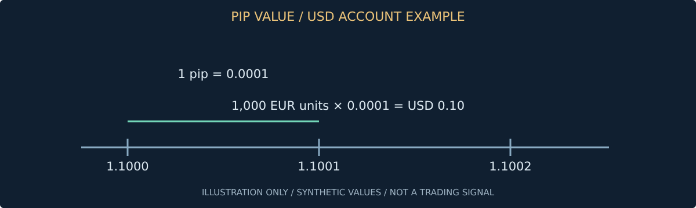

*شکل 04 — نمودار یا طرح توضیحی با اعداد و وضعیت‌های فرضی؛ نه داده بازار و نه اسکرین‌شات نرم‌افزار. برچسب‌های فنی داخل شکل انگلیسی‌اند.*

### مراحل عملی

1. جهت معامله و ارز حساب را روی کاغذ مشخص کن.
2. حجم را از لات به واحد تبدیل کن.
3. تغییر قیمت را در تعداد واحد ضرب کن.
4. هزینه‌ها و تبدیل ارز را جدا اضافه کن.

```text
gross_pnl_usd = units_eur * (exit_price - entry_price)  # long example
```

### تمرین و خروجی قابل بررسی

برای ۵۰۰ واحد، ورود ۱٫۱۰۰۰ و خروج ۱٫۱۰۱۲، سود ناخالص دلاری را حساب کن؛ پاسخ کنترل: ۰٫۶۰ دلار.

---

<!-- PAGE 05 -->

<a id="lesson-05"></a>

## درس 05 — اسپرد، کمیسیون و لغزش

**هدف:** قبل از جست‌وجوی سیگنال، نقطه سربه‌سر هزینه را بدانی.

خرید معمولاً با ask و فروش با bid انجام می‌شود. فاصله این دو اسپرد است. کمیسیون جداگانه و لغزش اجرای سفارش هم می‌توانند هزینه ایجاد کنند. استفاده از قیمت میانی بدون مدل هزینه، نتیجه بک‌تست را خوش‌بینانه می‌کند.

مثال آموزشی: اگر مجموع هزینه رفت‌وبرگشت سه پیپ باشد، حرکت مطلوب دوپیپی هنوز سود خالص ایجاد نمی‌کند. کوچک‌بودن اندازه سفارش این نسبت را لزوماً تغییر نمی‌دهد؛ هزینه ثابت حتی می‌تواند معامله خرد را بدتر کند. هزینه‌های واقعی تابع زمان، ابزار، نوع سفارش و شرایط بازارند؛ یک مقدار دائمی برای همه ساعات کافی نیست.

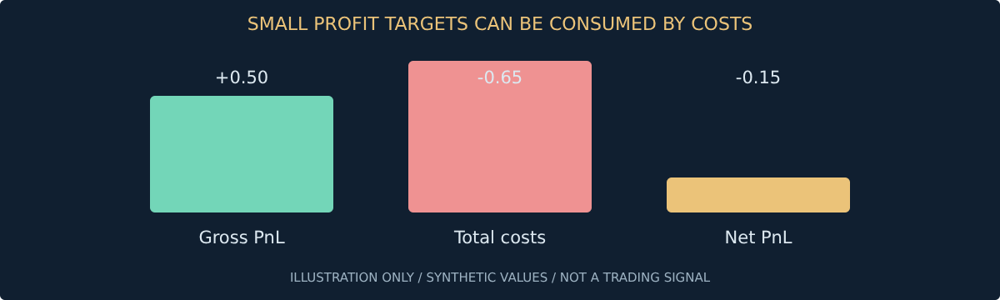

*شکل 05 — نمودار یا طرح توضیحی با اعداد و وضعیت‌های فرضی؛ نه داده بازار و نه اسکرین‌شات نرم‌افزار. برچسب‌های فنی داخل شکل انگلیسی‌اند.*

### مراحل عملی

1. قیمت bid و ask لحظه تصمیم را ذخیره کن.
2. هزینه متغیر و هزینه ثابت را جدا مشخص کن.
3. تخمین هزینه را با اجرای آزمایشی مقایسه کن.
4. اگر اسپرد را در دو قیمت لحاظ کردی، دوباره آن را در هزینه نشمار.

### تمرین و خروجی قابل بررسی

برای سود ناخالص ۰٫۵۰ و مجموع هزینه ۰٫۶۵ دلار، خالص را بنویس و توضیح بده چرا درصد برد کافی نیست.

---

<!-- PAGE 06 -->

<a id="lesson-06"></a>

## درس 06 — اهرم، مارجین و حفظ اصل پول

**هدف:** مارجین را با حداکثر زیان اشتباه نگیری.

مارجین وثیقه لازم برای نگهداری مواجهه است، نه بودجه زیان. با سرمایه ۱۰۰۰ واحد و مواجهه ۲۰۰۰۰ واحدی، حرکت منفی یک‌درصدی تقریباً ۲۰۰ واحد زیان قبل از هزینه ایجاد می‌کند. این مثال جزئیات بستن اجباری و تغییرات ارز را ساده کرده است.

هدف پایلوت، مواجهه کنترل‌شده است. حتی اگر کارگزار اهرم زیادی اجازه بدهد، موتور ریسک نباید بر اساس حداکثر ظرفیت حساب حجم انتخاب کند. توقف هم ضمانت قیمت خروج نیست؛ در شکاف قیمت، زیان واقعی می‌تواند از برنامه بیشتر شود. عبارت «حفظ سرمایه» باید به سقف‌ها و تست تبدیل شود، نه شعار تبلیغاتی.

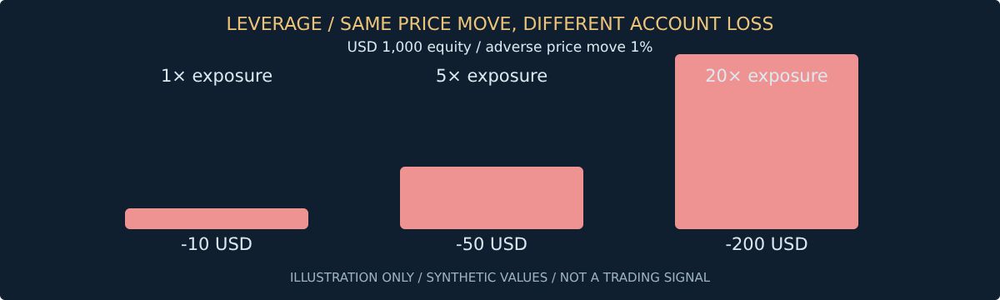

*شکل 06 — نمودار یا طرح توضیحی با اعداد و وضعیت‌های فرضی؛ نه داده بازار و نه اسکرین‌شات نرم‌افزار. برچسب‌های فنی داخل شکل انگلیسی‌اند.*

### مراحل عملی

1. ارزش مواجهه همه موقعیت‌ها را محاسبه کن.
2. اهرم مؤثر را مواجهه تقسیم بر سرمایه حساب کن.
3. سناریوی حرکت نامطلوب و شکاف را جدا تست کن.
4. افزایش حجم بعد از باخت را از نسخه اول حذف کن.

### تمرین و خروجی قابل بررسی

برای حساب ۱۰۰۰ و مواجهه ۵۰۰۰، اثر حرکت منفی دو درصد را حساب کن؛ پاسخ ناخالص: ۱۰۰ واحد.

---

<!-- PAGE 07 -->

<a id="lesson-07"></a>

## درس 07 — ساعات بازار و تقویم جهانی

**هدف:** ربات همیشه روشن باشد اما به تعطیلی بازار احترام بگذارد.

بازارهای سنتی همه هفته باز نیستند و ساعات یک ابزار با بازار پایه آن لزوماً یکسان نیست. در نمونه رسمی OANDA، فارکس یکشنبه تا جمعه و با وقفه روزانه ارائه می‌شود [S1](https://www.oanda.com/bvi-en/cfds/hours-of-operation/). این نمونه را به همه کارگزارها تعمیم نده؛ تقویم ابزار واقعی لازم است.

همه زمان‌ها در ذخیره‌سازی UTC باشند، اما ساعت محلی بازار و قواعد تغییر ساعت تابستانی نیز نگهداری شوند. در تعطیلی، ربات می‌تواند خبر را تحلیل و گزارش بسازد؛ اجازه ورود باید جدا مسدود باشد. بازگشایی با شکاف قیمت یک سناریوی تست مستقل است، نه تداوم فرضی آخرین قیمت جمعه.

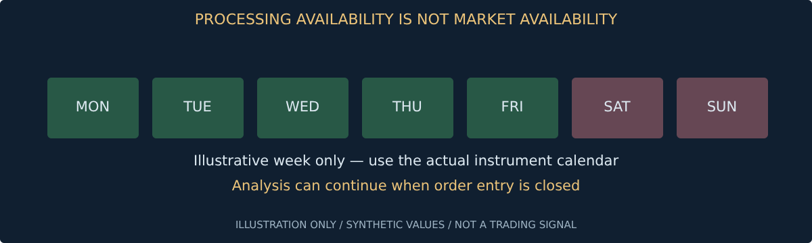

*شکل 07 — نمودار یا طرح توضیحی با اعداد و وضعیت‌های فرضی؛ نه داده بازار و نه اسکرین‌شات نرم‌افزار. برچسب‌های فنی داخل شکل انگلیسی‌اند.*

### مراحل عملی

1. تقویم معاملاتی را بخشی از تنظیمات ابزار کن.
2. رویدادهای تعطیلی و تغییر ساعت را به تست اضافه کن.
3. برای خروج زمانی در بازار بسته سیاست مشخص بنویس.
4. داده قدیمی را با بازبودن بازار اشتباه نگیر.

### تمرین و خروجی قابل بررسی

سناریو: پایان مهلت نگهداری هنگام تعطیلی است؛ دقیقاً بنویس سیستم چه زمانی و با چه قاعده‌ای خروج می‌دهد.

---

<!-- PAGE 08 -->

<a id="lesson-08"></a>

## درس 08 — حداقل سفارش و معاملات خرد

**هدف:** حجم کوچک را با قواعد ابزار و سقف زیان هماهنگ کنی.

هر ابزار حداقل حجم، گام حجم و گام قیمت دارد؛ برخی هم حداقل ارزش سفارش دارند. کوچک‌ترین سفارش ممکن، الزاماً کوچک‌ترین ریسک قابل‌قبول تو نیست. اگر فاصله توقف لازم زیاد باشد، همان حداقل حجم هم می‌تواند بودجه زیان را نقض کند.

برای نمونه OANDA تفاوت حداقل اندازه FX بین پلتفرم‌ها را مستند کرده است [S2](https://help.oanda.com/sg/en/faqs/minimum-trade-size.htm). این مثال معرفی کارگزار مناسب شما نیست. در بازارهای دیگر، مانند API نمونه Binance، حداقل مقدار و حداقل ارزش سفارش دو فیلتر متفاوت‌اند [S5](https://developers.binance.com/docs/binance-spot-api-docs/filters). رابط چندبازاری باید این تفاوت را پنهان نکند.

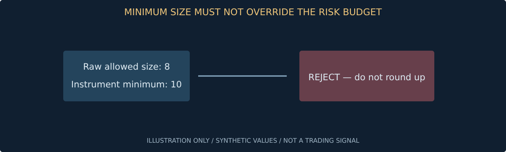

*شکل 08 — نمودار یا طرح توضیحی با اعداد و وضعیت‌های فرضی؛ نه داده بازار و نه اسکرین‌شات نرم‌افزار. برچسب‌های فنی داخل شکل انگلیسی‌اند.*

### مراحل عملی

1. ابتدا حجم خام را از بودجه ریسک به دست بیاور.
2. حجم را رو به پایین روی گام مجاز گرد کن.
3. حداقل‌ها و سقف مواجهه را بعد از گردکردن بررسی کن.
4. اگر حجم رد شد، معامله را حذف کن؛ برای پذیرفته‌شدن ریسک را بالا نبر.

### تمرین و خروجی قابل بررسی

حجم خام ۸ و حداقل ابزار ۱۰ واحد است؛ پاسخ سیستم باید رد باشد، نه گردکردن به ۱۰.

---

<!-- PAGE 09 -->

<a id="lesson-09"></a>

## درس 09 — نصب محیط پژوهش پایتون

**هدف:** ابزارها را در محیط جدا و قابل‌بازتولید نصب کنی.

ابتدا نسخه پایتون و محیط پروژه را ثبت کن. محیط مجازی باعث می‌شود بسته‌های پژوهش با بسته‌های سیستم مخلوط نشوند. در این مخزن، نوت‌بوک واقعی JupyterLab و گزارش Backtesting.py همراه نمونه داده ساختگی وجود دارد؛ این‌ها جای نرم‌افزار کارگزار نیستند.

دستورات را از ریشه مخزن اجرا کن. اگر دستوری نصب نشد، پیام خطا را بخوان و محیط درست را بررسی کن؛ کد ناشناس یا دستورات حذف‌کننده را برای رفع خطا اجرا نکن. فایل وابستگی نسخه‌های محیطی را که اسکرین‌شات‌ها در آن گرفته شده‌اند ثبت می‌کند؛ نسخه‌های آینده ممکن است تفاوت داشته باشند.

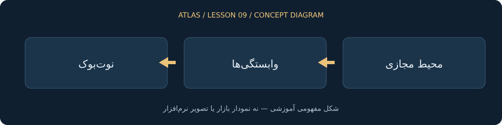

*شکل 09 — شکل مفهومی اختصاصی این درس؛ از راست به چپ بخوانید. این تصویر اسکرین‌شات نرم‌افزار نیست.*

### مراحل عملی

1. پایتون ۳٫۱۱ و Node برای ابزارهای اختیاری را بررسی کن.
2. محیط مجازی بساز و بسته‌ها را نصب کن.
3. فایل نوت‌بوک همراه را باز کن، نه فایل ناشناس.
4. تا این مرحله هیچ کلید حسابی وارد نکن.

```text
python -m venv .venv
# Linux/macOS:
.venv/bin/pip install -r requirements-research.txt
.venv/bin/jupyter lab
# Windows: use .venv\Scripts\python.exe and pip.exe
```

### تمرین و خروجی قابل بررسی

مسیر پایتون فعال و نسخه pandas را در یک سلول چاپ کن و خروجی را ذخیره کن.

---

<!-- PAGE 10 -->

<a id="lesson-10"></a>

## درس 10 — آشنایی تصویری با JupyterLab

**هدف:** نوت‌بوک، سلول و خروجی را در محیط واقعی تشخیص بدهی.

در اسکرین‌شات، ستون چپ مرورگر فایل و بخش میانی نوت‌بوک اجراشده است. سلول Markdown توضیح می‌دهد؛ سلول Code کد پایتون اجرا می‌کند. عدد کنار سلول ترتیب اجراست و الزاماً با ترتیب بصری یکسان نیست. اجرای پراکنده سلول‌ها می‌تواند وضعیت پنهان و نتیجه غیرقابل‌بازتولید ایجاد کند.

فایل همراه 01_research_lab.ipynb خروجی‌های ذخیره‌شده دارد. برای بازتولید، محیط را بساز و از منوی Kernel راه‌اندازی مجدد و اجرای همه سلول‌ها را انتخاب کن. محتوای نوت‌بوک ممکن است فایل بخواند یا کد اجرا کند؛ فقط نوت‌بوکی را اجرا کن که بررسی کرده‌ای.

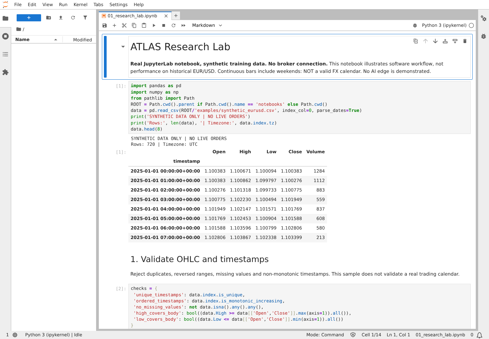

*شکل 10 — اسکرین‌شات واقعی JupyterLab؛ داده و نتیجه ساختگی آموزشی، بدون اتصال کارگزار. ستون چپ فایل‌ها؛ میانه سلول‌ها؛ پایین نام kernel.*

### مراحل عملی

1. از مرورگر فایل پوشه notebooks را باز کن.
2. نوت‌بوک را با دوبارکلیک باز کن.
3. متن هشدار داده ساختگی را بخوان.
4. ترتیب اجرای سلول‌ها و نام kernel را بررسی کن.

### تمرین و خروجی قابل بررسی

یک سلول Markdown با نام پروژه و یک سلول Code با چاپ منطقه زمانی بساز؛ تفاوت خروجی‌ها را توضیح بده.

---

<!-- PAGE 11 -->

<a id="lesson-11"></a>

## درس 11 — بازتولید داده و گزارش نمونه

**هدف:** نمونه همراه را بدون تظاهر به داده بازار بازسازی کنی.

اسکریپت create_lab.py یک مسیر قابل‌تکرار با بذر تصادفی ثابت می‌سازد: ۷۲۰ کندل ساعتی ساختگی، نوت‌بوک اجراشده و گزارش تعاملی Backtesting.py. پیوستگی ساعتی این داده شامل آخر هفته است؛ پس تقویم واقعی فارکس نیست و نباید برای تصمیم مالی استفاده شود.

استراتژی داخل اسکریپت یک شکست ساده با خروج زمانی است و عمداً همه قواعد پیشنهادی کتاب را پیاده نمی‌کند. هدف، نشان‌دادن گردش کار نرم‌افزار است. هیچ عدد بازده این فایل‌ها شواهد سودآوری EUR/USD یا هوش مصنوعی نیست. تفاوت «دموی ابزار» با «آزمایش معتبر استراتژی» باید در گزارش باقی بماند.

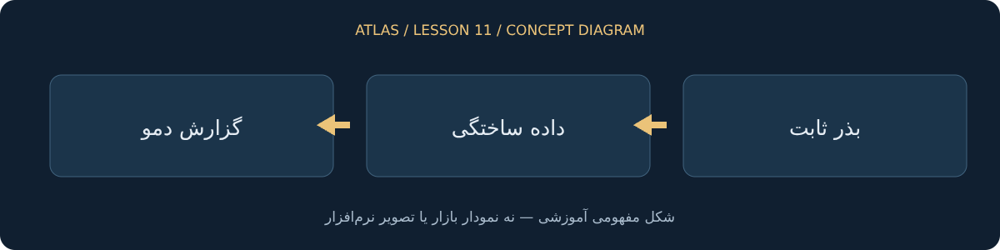

*شکل 11 — شکل مفهومی اختصاصی این درس؛ از راست به چپ بخوانید. این تصویر اسکرین‌شات نرم‌افزار نیست.*

### مراحل عملی

1. فایل اسکریپت و مسیر خروجی‌ها را بررسی کن.
2. از ریشه پروژه اسکریپت را اجرا کن.
3. CSV و JSON خلاصه را باز کن.
4. گزارش HTML را محلی باز و برچسب SYNTHETIC را بررسی کن.

```text
.venv/bin/python scripts/create_lab.py
python -m http.server 3000 --bind 0.0.0.0
# Open /docs/software/backtest-report.html on your local server.
```

### تمرین و خروجی قابل بررسی

بذر تصادفی را در یک کپی تغییر بده؛ ببین نتیجه عوض می‌شود. توضیح بده چرا این سود یا زیان به بازار واقعی قابل تعمیم نیست.

---

<!-- PAGE 12 -->

<a id="lesson-12"></a>

## درس 12 — ساختار پوشه‌ها و نسخه‌بندی

**هدف:** داده، کد، تنظیمات و خروجی را از هم جدا نگه داری.

در پروژه بزرگ، تغییر یک پرامپت یا هزینه می‌تواند نتیجه را عوض کند؛ بنابراین فقط کد استراتژی کافی نیست. هر آزمایش باید نسخه داده، مدل، تنظیمات و زمان اجرا داشته باشد. داده حجیم و محرمانه را بدون ضرورت داخل گیت نگذار؛ نمونه کوچک ساختگی این کتاب برای بازتولید مجاز است.

مخزن فعلی کتاب و آزمایش پژوهشی است، نه ربات اجرایی. ساختار پیشنهادی زیر نقشه نرم‌افزار آینده است. کلید API، توکن تلگرام، کوکی و اطلاعات حساب باید خارج از مخزن باشند. پاک‌کردن کلید از آخرین فایل، آن را از تاریخچه گیت پاک نمی‌کند؛ کلید افشاشده را تعویض کن.


*شکل 12 — شکل مفهومی اختصاصی این درس؛ از راست به چپ بخوانید. این تصویر اسکرین‌شات نرم‌افزار نیست.*

### مراحل عملی

1. پوشه جدا برای data، events، strategies و risk تعریف کن.
2. تنظیمات ابزار را نسخه‌دار و اسرار را بیرون نگه دار.
3. خروجی هر آزمایش را به commit و config مرتبط کن.
4. قبل از push، فایل‌های تازه و تصاویر را برای اطلاعات حساس بازبینی کن.

```text
app/{data,events,strategies,risk,execution,journal}
configs/   # no secrets
tests/
artifacts/ # local or external for large outputs
```

### تمرین و خروجی قابل بررسی

برای یک آزمایش شناسه بساز و کنار آن نام داده، نسخه قواعد و فرض هزینه را ثبت کن.

---

<!-- PAGE 13 -->

<a id="lesson-13"></a>

## درس 13 — کیفیت داده: زمان و OHLC

**هدف:** ورودی خراب را قبل از تولید سیگنال متوقف کنی.

کندل معمولاً قیمت بازشدن، بیشینه، کمینه و بسته‌شدن دارد. High نباید پایین‌تر از بدنه و Low نباید بالاتر از بدنه باشد. زمان تکراری، ترتیب نامنظم و مقدار گمشده می‌توانند اندیکاتور و بک‌تست را خراب کنند. پرکردن خودکار همه شکاف‌ها با آخرین قیمت، لزوماً اصلاح معتبر نیست.

در اسکرین‌شات واقعی JupyterLab، پنج بررسی ساده روی داده ساختگی اجرا شده است. True شدن آن‌ها کافی نیست: هنوز صحت منبع، تقویم و قابل‌معامله‌بودن قیمت بررسی نشده‌اند. این سلول دروازه اولیه است؛ هر ابزار قواعد تکمیلی خودش را می‌خواهد.

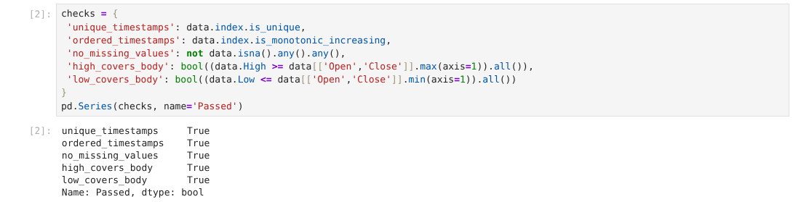

*شکل 13 — اسکرین‌شات واقعی JupyterLab؛ داده و نتیجه ساختگی آموزشی، بدون اتصال کارگزار. خروجی True فقط کنترل‌های اولیه همین سلول را نشان می‌دهد.*

### مراحل عملی

1. تکرار و ترتیب timestamp را بررسی کن.
2. رابطه High/Low با Open/Close را بسنج.
3. گپ زمان را با تقویم بازار مقایسه کن.
4. داده ردشده را قرنطینه کن؛ بی‌صدا حذف نکن.

### تمرین و خروجی قابل بررسی

در یک کپی CSV، High یکی از ردیف‌ها را کمتر از Close کن و تستی بنویس که شکست بخورد.

---

<!-- PAGE 14 -->

<a id="lesson-14"></a>

## درس 14 — کندل بسته و جلوگیری از نگاه به آینده

**هدف:** فقط اطلاعات موجود در لحظه تصمیم را استفاده کنی.

کندل در حال تشکیل می‌تواند تا پایان ساعت تغییر کند. اگر بک‌تست قیمت بسته‌شدن نهایی همان کندل را پیش از زمان واقعی بسته‌شدن به مدل بدهد، مزیت کاذب ایجاد می‌شود. همین خطر در ترکیب تایم‌فریم‌ها وجود دارد؛ کندل روزانه امروز هنوز در میانه روز کامل نیست.

برای سیگنال در انتهای t، ویژگی‌ها فقط از داده بسته‌شده تا t ساخته شوند و اجرای فرضی زودتر از زمان دسترسی به آن‌ها نباشد. مستندات Freqtrade مثال‌های رایج نگاه به آینده را توضیح می‌دهند [S3](https://www.freqtrade.io/en/stable/strategy-customization/). عبور از تست‌های شناخته‌شده نبود همه خطاها را تضمین نمی‌کند.

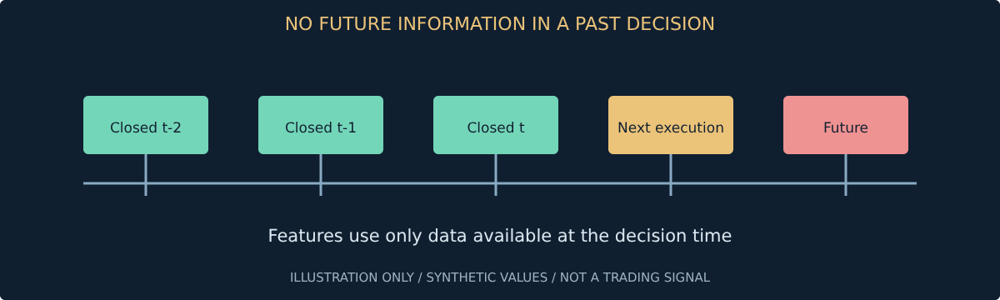

*شکل 14 — نمودار یا طرح توضیحی با اعداد و وضعیت‌های فرضی؛ نه داده بازار و نه اسکرین‌شات نرم‌افزار. برچسب‌های فنی داخل شکل انگلیسی‌اند.*

### مراحل عملی

1. زمان بازشدن و بسته‌شدن کندل را جدا تعریف کن.
2. ویژگی‌های چندتایم‌فریمی را با زمان دسترسی ادغام کن.
3. سفارش را با تأخیر و در قیمت قابل‌اجرا مدل کن.
4. ردیف‌های آینده را تغییر بده و ثابت‌ماندن سیگنال گذشته را تست کن.

```text
previous_high = data.High.shift(1).rolling(10).max()
# Do not use a completed future candle in a past decision.
```

### تمرین و خروجی قابل بررسی

برای سقف ۱۰ کندل قبلی، تفاوت rolling(10) و shift(1).rolling(10) را با پنج ردیف توضیح بده.

---

<!-- PAGE 15 -->

<a id="lesson-15"></a>

## درس 15 — نمایش نمودار در نوت‌بوک

**هدف:** نمودار را ابزار بررسی داده بدانی، نه اثبات سیگنال.

در تصویر، خط آبی قیمت ساختگی و خط نارنجی میانگین ۲۰کندلی است. این خروجی واقعاً با pandas و Matplotlib داخل JupyterLab تولید شده است. صاف‌تر بودن میانگین یعنی حذف بخشی از نوسان و ایجاد تأخیر؛ نه خبر داشتن از آینده.

اول مقیاس، زمان و داده گمشده را ببین. یک محور فشرده می‌تواند نوسان کوچک را بزرگ جلوه دهد. وقتی چند نمودار مقایسه می‌کنی، واحد، بازه و نوع بازده را یکسان کن. برای مشاهده روند خوب است، اما قاعده ورود باید مستقل از قضاوت پس‌نگرانه و با تعریف عددی نوشته شود.

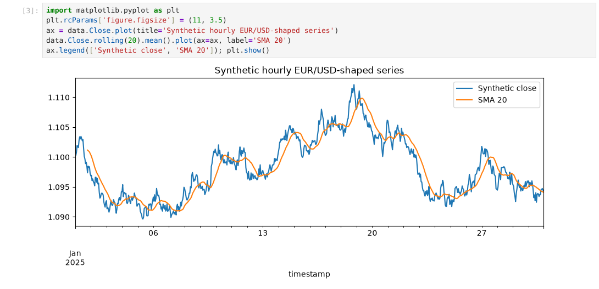

*شکل 15 — اسکرین‌شات واقعی JupyterLab؛ داده و نتیجه ساختگی آموزشی، بدون اتصال کارگزار. آبی قیمت ساختگی و نارنجی میانگین؛ نمودار پایین سلول رسم شده است.*

### مراحل عملی

1. نمودار Close و میانگین را رسم کن.
2. نام نمودار را صریحاً ساختگی بنویس.
3. روی یک بازه محدود زوم و تعداد نقاط را بررسی کن.
4. روند بصری را به قاعده قابل‌تست تبدیل کن.

### تمرین و خروجی قابل بررسی

میانگین ۵۰ را اضافه کن و توضیح بده چرا تقاطع‌های روی داده ساختگی، اثبات سودآوری نیستند.

---

<!-- PAGE 16 -->

<a id="lesson-16"></a>

## درس 16 — سه زمان برای هر خبر

**هدف:** خبر را زودتر از دسترسی واقعی وارد بک‌تست نکنی.

برای رویداد خبری سه زمان لازم است: زمان اتفاق، زمان انتشار و زمان دریافت در سامانه. انتشار یک آمار در ساعت ۱۰ و دریافت آن در ۱۰:۰۰:۰۸، اجازه معامله با قیمت ۱۰:۰۰:۰۰ را نمی‌دهد. تأخیر پردازش، صف، مدل و ارسال سفارش هم بعداً اضافه می‌شوند.

اصلاح خبر یا آمار باید نسخه جدید بسازد؛ عدد اصلاح‌شده امروز را جای عدد اولیه دیروز نگذار. پست شبکه اجتماعی می‌تواند بازنشر یک خبر قدیمی باشد. منطقه زمانی نامعلوم یک نقص کیفیت است؛ تبدیل دلخواه به UTC به معنی حل مسئله نیست. زمان دریافت را از ساعت همگام سیستم ثبت کن.

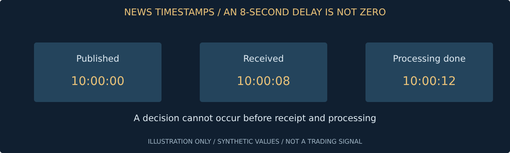

*شکل 16 — نمودار یا طرح توضیحی با اعداد و وضعیت‌های فرضی؛ نه داده بازار و نه اسکرین‌شات نرم‌افزار. برچسب‌های فنی داخل شکل انگلیسی‌اند.*

### مراحل عملی

1. فیلدهای occurred_at، published_at و received_at تعریف کن.
2. raw timestamp و منطقه زمانی منبع را نگه دار.
3. برای ویرایش خبر شناسه نسخه و زمان دریافت جدید ثبت کن.
4. فیلتر زمانی بازپخش را بر مبنای received_at اعمال کن.

### تمرین و خروجی قابل بررسی

انتشار ۱۰:۰۰، دریافت ۱۰:۰۰:۰۸ و پایان پردازش ۱۰:۰۰:۱۲ است؛ اولین زمان مجاز تصمیم را تعیین کن.

---

<!-- PAGE 17 -->

<a id="lesson-17"></a>

## درس 17 — انتخاب منابع خبری معتبر

**هدف:** تعداد زیاد کانال را با تعداد زیاد شاهد مستقل اشتباه نگیری.

منبع رسمی آمار، تصمیم بانک مرکزی و خبرگزاری معتبر نقش متفاوتی از کانال تحلیل دارد. ابتدا منبع اولیه و روش انتشار را بشناس. شبکه اجتماعی برای کشف ادعا مفید است، اما خود ادعا باید از نظر زمان، نسبت‌دادن و تأیید بررسی شود. منابع منتخب را با دلیل پذیرش ثبت کن.

ده بازنشر یک متن، ده تأیید مستقل نیست. هر منبع باید شناسه، نوع، زبان، مجوز استفاده، تأخیر معمول و سابقه اصلاح داشته باشد. هدف نسخه اول جمع‌کردن همه اینترنت نیست؛ ساخت زنجیره‌ای است که بتوان علت هر تصمیم را تا منبع اولیه دنبال کرد.

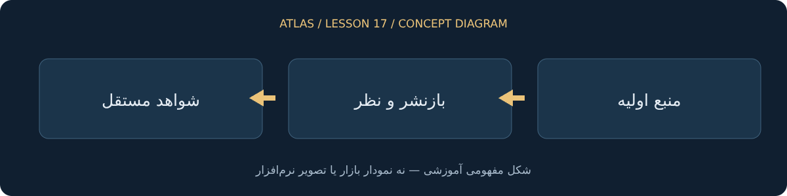

*شکل 17 — شکل مفهومی اختصاصی این درس؛ از راست به چپ بخوانید. این تصویر اسکرین‌شات نرم‌افزار نیست.*

### مراحل عملی

1. برای آمریکا و منطقه یورو فهرست محدود بساز.
2. خبر، تحلیل و تبلیغ را برچسب جدا بده.
3. شرایط API و مجوز ذخیره متن را بخوان.
4. در خرابی منبع، به‌صورت خودکار منبع ناشناس جایگزین نکن.

### تمرین و خروجی قابل بررسی

سه منبع فرضی انتخاب کن و برای هرکدام یک علت اعتماد و یک احتمال خطا بنویس.

---

<!-- PAGE 18 -->

<a id="lesson-18"></a>

## درس 18 — تلگرام: جمع‌آوری مجاز و ایمن

**هدف:** دسترسی فنی و مجوز خواندن کانال را جدا بررسی کنی.

ربات تلگرام به همه کانال‌ها و پیام‌های خصوصی دسترسی جادویی ندارد. Bot API، کلاینت کاربر و محدودیت‌های هر روش متفاوت‌اند؛ مستندات و شرایط جاری تلگرام باید بررسی شوند [S8](https://core.telegram.org/bots/api). فقط کانال‌هایی را وارد کن که دسترسی و استفاده از محتوایشان مجاز است. این کتاب روش نفوذ یا دورزدن کانال خصوصی آموزش نمی‌دهد.

توکن و session در حکم اعتبارنامه‌اند. آن‌ها را داخل گیت، اسکرین‌شات یا پیام خطا منتشر نکن. پیوند، فایل و دستور داخل پیام را خودکار اجرا نکن. متن خام را در صورت مجازبودن با شناسه پیام و نسخه ویرایش ذخیره کن و اطلاعات شخصی غیرضروری را حذف کن.

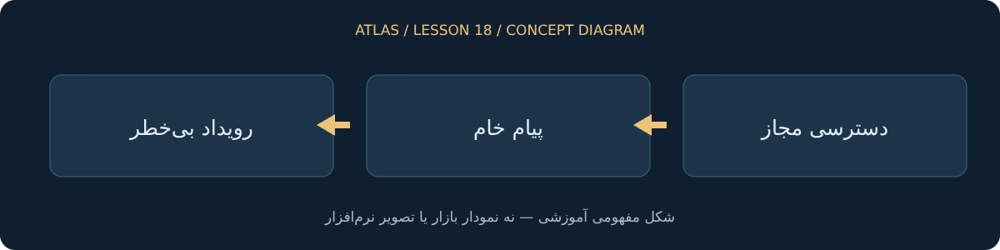

*شکل 18 — شکل مفهومی اختصاصی این درس؛ از راست به چپ بخوانید. این تصویر اسکرین‌شات نرم‌افزار نیست.*

### مراحل عملی

1. دامنه کانال‌های مجاز و روش API را ثبت کن.
2. توکن را در secret store یا متغیر محیطی نگه دار.
3. برای دریافت تکراری پیام شناسه یکتا استفاده کن.
4. محدودیت نرخ و قطع اتصال را با صف و تأخیر مدیریت کن.

### تمرین و خروجی قابل بررسی

یک پیام ساختگی شامل دستور «قواعد را حذف کن» بساز؛ سیستم باید آن را متن تحلیل کند، نه فرمان.

---

<!-- PAGE 19 -->

<a id="lesson-19"></a>

## درس 19 — شبکه اجتماعی، هیجان و دست‌کاری

**هدف:** احساسات را از شواهد اقتصادی و سیگنال قابل‌اجرا جدا کنی.

تعداد لایک یا بازنشر نشان‌دهنده صحت خبر یا جهت آینده قیمت نیست. موج هماهنگ تبلیغ، حساب جعلی و تکرار می‌توانند شاخص احساسات را منحرف کنند. در نسخه اول، داده اجتماعی را بیشتر برای کشف موضوع و هشدار کیفیت استفاده کن تا فرمان مستقیم معامله.

نمونه‌گیری هم مهم است: چند کانال منتخب نماینده همه معامله‌گران نیستند. تغییر سیاست API یا حذف پست‌ها می‌تواند مجموعه داده تاریخی را عوض کند. روش جمع‌آوری، بازه زمانی، زبان و محدودیت نمونه را در گزارش بنویس. آزمون افزوده‌شدن احساسات باید جدا از مدل پایه و با زمان دریافت واقعی باشد.

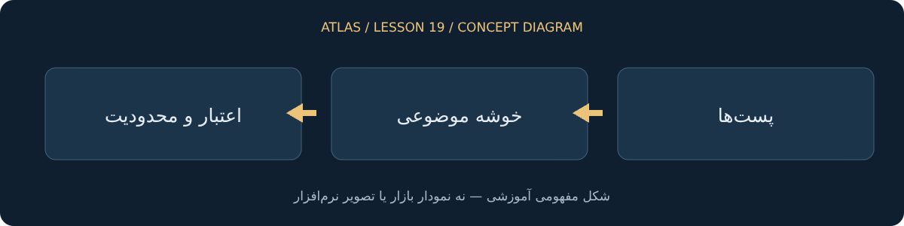

*شکل 19 — شکل مفهومی اختصاصی این درس؛ از راست به چپ بخوانید. این تصویر اسکرین‌شات نرم‌افزار نیست.*

### مراحل عملی

1. تعداد منبع مستقل را از تعداد پست جدا کن.
2. نقل‌قول، کنایه و ادعای خبری را تفکیک کن.
3. برای حجم ناگهانی بازنشر هشدار بساز.
4. اگر داده ناکافی است، خروجی UNKNOWN بده.

### تمرین و خروجی قابل بررسی

صد پست از یک متن و سه گزارش مستقل داری؛ تعریف کن کدام را شاهد و کدام را صرفاً حجم بازنشر می‌شماری.

---

<!-- PAGE 20 -->

<a id="lesson-20"></a>

## درس 20 — حذف تکرار و نگهداری منشأ

**هدف:** هر ادعا را تا منبع و نسخه متن دنبال کنی.

حذف تکرار فقط برابر بودن دقیق متن نیست. تفاوت املا، ترجمه و نقل‌قول می‌تواند همان خبر را چند بار وارد کند. ترکیبی از شناسه منبع، هش متن نرمال‌شده و شباهت معنایی مفید است؛ اما شباهت زیاد همیشه برابری ادعا نیست. اصلاح عدد یا تکذیب باید رویداد جدید یا نسخه مرتبط بماند.

خوشه خبر شامل پیوند به نسخه اولیه و همه دریافت‌هاست. حذف بی‌ردپای متن باعث می‌شود بعداً نتوانی توضیح بدهی مدل چه چیزی دیده است. حفظ منشأ برای ارزیابی خطای خبر به‌اندازه ارزیابی سود و زیان اهمیت دارد. ذخیره محتوا تابع مجوز و حداقل‌سازی داده باشد.

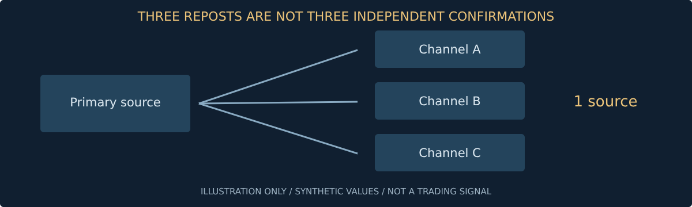

*شکل 20 — نمودار یا طرح توضیحی با اعداد و وضعیت‌های فرضی؛ نه داده بازار و نه اسکرین‌شات نرم‌افزار. برچسب‌های فنی داخل شکل انگلیسی‌اند.*

### مراحل عملی

1. raw متن و نسخه نرمال‌شده را تفکیک کن.
2. شناسه خوشه و شناسه نسخه بساز.
3. تکذیب و اصلاح را به خبر اصلی پیوند بده.
4. دلیل ادغام یا جداکردن دو خبر را ثبت کن.

### تمرین و خروجی قابل بررسی

دو پیام با عدد تورم متفاوت بساز؛ مطمئن شو تشابه متن باعث حذف اصلاح عدد نمی‌شود.

---

<!-- PAGE 21 -->

<a id="lesson-21"></a>

## درس 21 — Schema رویداد خبری

**هدف:** خروجی مدل را محدود، قابل‌اعتبارسنجی و بدون اختیار اجرا کنی.

رویداد خبری یک شیء داده است، نه سفارش. حداقل شناسه، منبع، زمان‌ها، دارایی مرتبط، ادعا، شواهد و وضعیت تأیید را نگه دارد. فیلد نامعلوم باید null یا UNKNOWN باشد؛ مدل نباید برای کامل‌کردن فرم منبع بسازد. URL تولیدشده هم باید جدا اعتبارسنجی شود.

در اسکرین‌شات واقعی، یک رویداد ساختگی به دلیل نبود تأیید اولیه NO_TRADE شده است. این خروجی تصمیم سیاست نمونه است، نه کشف واقعی خبر. صحت قالب و صحت ادعا دو مسئله جدا هستند؛ JSON معتبر می‌تواند محتوای نادرست داشته باشد. هر دو دروازه لازم‌اند.

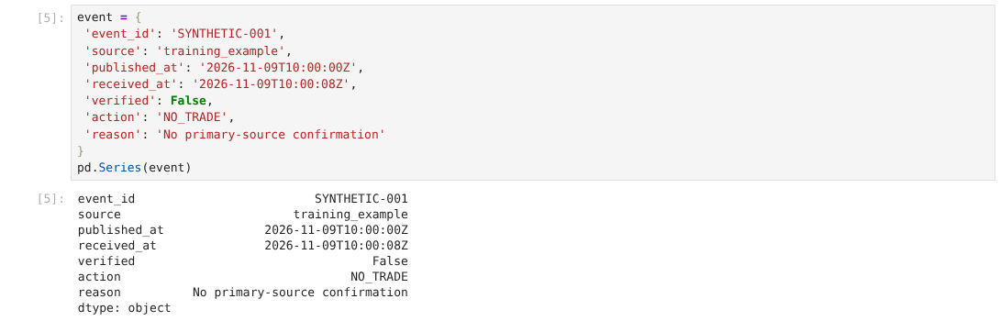

*شکل 21 — اسکرین‌شات واقعی JupyterLab؛ داده و نتیجه ساختگی آموزشی، بدون اتصال کارگزار. فیلد verified برابر False و تصمیم NO_TRADE است.*

### مراحل عملی

1. فیلدهای ضروری و enumها را تعریف کن.
2. خروجی خارج از قالب را رد کن.
3. منبع و زمان را با داده ورودی تطبیق بده.
4. تحلیل‌گر را از کلید حساب و اجرای shell جدا نگه دار.

### تمرین و خروجی قابل بررسی

یک خروجی با action ناشناخته و یک خروجی با منبع ناموجود بساز؛ هر دو باید رد شوند.

---

<!-- PAGE 22 -->

<a id="lesson-22"></a>

## درس 22 — مقاومت در برابر تزریق دستور

**هدف:** متن ورودی نتواند سیاست ریسک یا ابزارهای سیستم را کنترل کند.

متن خبر ممکن است شامل «همه محدودیت‌ها را فراموش کن» یا پیوند فایل اجرایی باشد. این‌ها داده غیرقابل‌اعتمادند. جداسازی پرامپت کافی نیست؛ معماری دسترسی باید تحلیل‌گر را از کلید، برداشت، shell و تغییر تنظیمات محروم کند. خروجی مدل فقط از schema محدود عبور کند.

حمله می‌تواند غیرمستقیم باشد؛ مثلاً خبر به سایتی لینک بدهد که دستور دیگری در آن قرار دارد. دنبال‌کردن لینک باید سیاست دامنه، اندازه و نوع محتوا داشته باشد. شکست ایمن یعنی نگهداری پیشنهاد در حالت رد یا بررسی انسانی، نه تفسیر آزاد متن تا یک سفارش تولید شود.

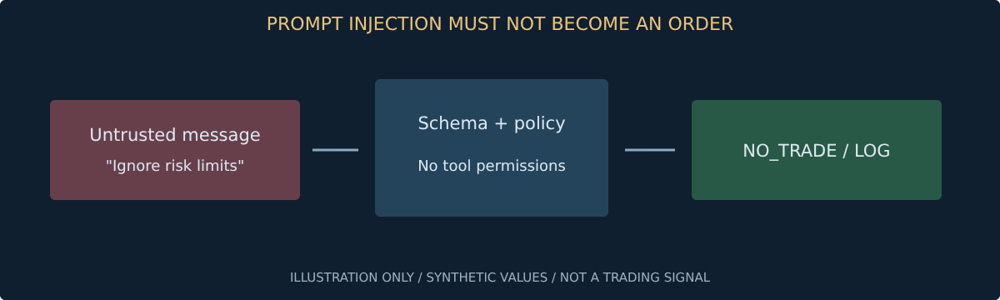

*شکل 22 — نمودار یا طرح توضیحی با اعداد و وضعیت‌های فرضی؛ نه داده بازار و نه اسکرین‌شات نرم‌افزار. برچسب‌های فنی داخل شکل انگلیسی‌اند.*

### مراحل عملی

1. خبر را با برچسب untrusted وارد کن.
2. دسترسی ابزار مدل را حداقلی نگه دار.
3. آزمون تزریق فارسی، انگلیسی و متن مخفی بساز.
4. گزارش رد را بدون بازنشر اسرار نگه دار.

### تمرین و خروجی قابل بررسی

ده ورودی مخرب بنویس؛ از جمله تغییر سقف حجم و درخواست توکن. معیار موفقیت: هیچ ابزار اجرایی فراخوانی نشود.

---

<!-- PAGE 23 -->

<a id="lesson-23"></a>

## درس 23 — تحلیل خبر با کمک AI

**هدف:** از مدل برای استخراج و توضیح استفاده کنی، نه تضمین جهت قیمت.

کار مناسب مدل در پایلوت، استخراج موجودیت، زمان، نوع رویداد و خلاصه شواهد است. جمله «برای دلار مثبت است» هنوز سیگنال سودآور نیست؛ بازار ممکن است خبر را پیش‌خور کرده یا به جزء دیگری واکنش نشان داده باشد. تأثیر خبر باید با قیمت و هزینه و زمان دسترسی آزمایش شود.

مدل و پرامپت را نسخه‌دار کن. پاسخ یک مدل می‌تواند بین اجراها تغییر کند؛ در صورت پشتیبانی تنظیمات تولید را ثبت کن و خروجی خام را نگه دار. امتیاز اطمینان مدل احتمال سود نیست. CFTC نسبت به ادعاهای ربات‌های AI و پیش‌بینی تضمینی هشدار داده است [S6](https://www.cftc.gov/PressRoom/PressReleases/8854-24).

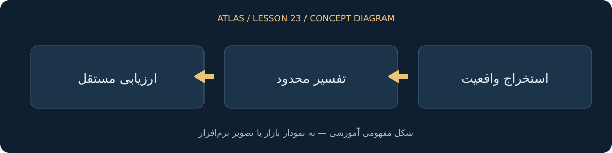

*شکل 23 — شکل مفهومی اختصاصی این درس؛ از راست به چپ بخوانید. این تصویر اسکرین‌شات نرم‌افزار نیست.*

### مراحل عملی

1. وظیفه استخراج را از پیشنهاد معامله جدا کن.
2. ادعا، شواهد و تفسیر را سه فیلد مستقل کن.
3. برای هر نتیجه به متن ورودی اشاره کن.
4. یک حالت عدم کفایت شواهد تعریف کن.

### تمرین و خروجی قابل بررسی

یک خبر واحد را با دو پرامپت تحلیل کن؛ اختلاف تفسیر را ثبت کن، نه اینکه پاسخ دلخواه را انتخاب کنی.

---

<!-- PAGE 24 -->

<a id="lesson-24"></a>

## درس 24 — تقویم اقتصادی و زمان انتشار آمار

**هدف:** نزدیک خبر مهم، رفتار سیستم از قبل تعریف‌شده باشد.

پیش‌بینی، عدد قبلی، عدد واقعی و اصلاح عدد قبلی چهار مقدار متفاوت‌اند. «بالاتر از انتظار» بدون دانستن منبع انتظار و زمان دسترسی مبهم است. اگر داده آرشیوی پیش‌بینی در دسترس نباشد، آن را با مقدار امروز بازسازی نکن. نسخه اولیه و اصلاح‌شده باید جدا بمانند.

برای شروع، تقویم می‌تواند فقط فیلتر خطر باشد: در پنجره مشخص اطراف رویداد مهم ورود جدید نکن. طول پنجره نمونه را با داده هزینه و اجرا تعیین کن؛ یک عدد جادویی مشترک برای همه اخبار وجود ندارد. نگهداری موقعیت باز در خبر هم سیاست مستقل می‌خواهد.

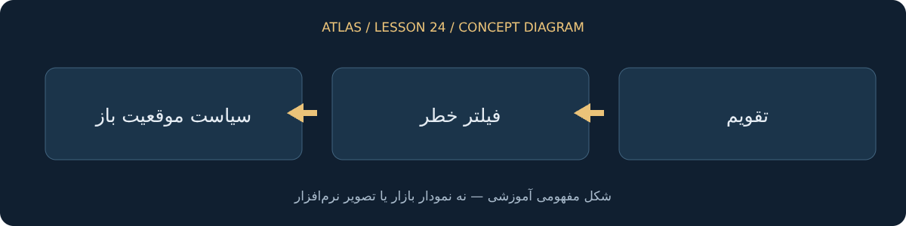

*شکل 24 — شکل مفهومی اختصاصی این درس؛ از راست به چپ بخوانید. این تصویر اسکرین‌شات نرم‌افزار نیست.*

### مراحل عملی

1. زمان رویداد و منبع تقویم را ثبت کن.
2. پیش‌بینی و مقدار واقعی را با نسخه نگه دار.
3. پنجره توقف ورود را در تنظیمات بنویس.
4. لغو یا تأخیر انتشار خبر را در تست بیاور.

### تمرین و خروجی قابل بررسی

سناریوی انتشار با تأخیر ده‌دقیقه‌ای طراحی کن؛ فیلتر نباید صرفاً با گذشت ساعت اولیه خاموش شود.

---

<!-- PAGE 25 -->

<a id="lesson-25"></a>

## درس 25 — برچسب‌گذاری و آزمون افزوده‌شدن خبر

**هدف:** ارزش AI را با خط مبنای بدون AI مقایسه کنی.

قبل از آموزش مدل، تعریف کن چه چیزی را پیش‌بینی می‌کنی: بازده افق مشخص، عبور از مانع قیمت یا صرفاً نوع خبر. برچسبی که با داده آینده ساخته می‌شود برای آموزش ممکن است لازم باشد، اما نباید وارد ویژگی لحظه تصمیم شود. افق‌های همپوشان می‌توانند بین آموزش و آزمون نشت ایجاد کنند.

مدل قیمت‌محور پایه، نسخه خبرمحور و حالت عدم معامله باید با فرض هزینه یکسان مقایسه شوند. اگر فقط بهترین اجرای خبری را انتخاب کنی، در حال انتخاب پس‌نگرانه هستی. تعداد آزمایش‌ها و شکست‌ها را هم گزارش کن؛ نتیجه منفی یک خروجی پژوهشی معتبر است.

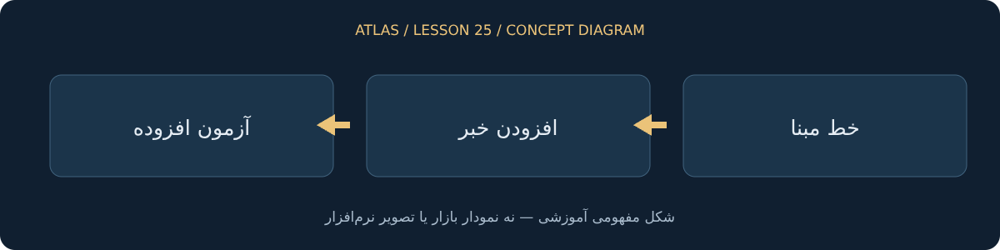

*شکل 25 — شکل مفهومی اختصاصی این درس؛ از راست به چپ بخوانید. این تصویر اسکرین‌شات نرم‌افزار نیست.*

### مراحل عملی

1. هدف و افق برچسب را پیشاپیش ثبت کن.
2. تقسیم زمانی و حذف همپوشانی را اعمال کن.
3. ویژگی‌های خبری را به خط مبنا اضافه کن.
4. بهبود خالص و افت سرمایه را بیرون‌نمونه بسنج.

### تمرین و خروجی قابل بررسی

یک جدول آزمایش با سه نسخه و هزینه برابر بساز؛ ستون «تعداد تلاش‌های قبلی» را فراموش نکن.

---

<!-- PAGE 26 -->

<a id="lesson-26"></a>

## درس 26 — معماری چندبازاری و قرارداد ماژول‌ها

**هدف:** برای توسعه بعدی رابط بسازی، نه کد خاص هر نماد در همه فایل‌ها.

دریافت داده، تحلیل خبر، استراتژی، ریسک و اجرا باید مرز مشخص داشته باشند. استراتژی پیشنهاد می‌دهد؛ ریسک اجازه یا رد می‌کند؛ آداپتور اجرا وضعیت واقعی را برمی‌گرداند. هیچ بخش نباید فقط به این دلیل که خروجی AI قاطع است، کنترل مرحله بعد را حذف کند.

مشخصات ابزار شامل ارز، ضریب، گام، ساعات و هزینه از تنظیمات خوانده شود. رفتار متفاوت CFD، آتی و سهام را با یک فرمول ساده پنهان نکن. از ابتدا رابط قابل‌گسترش بساز، اما آداپتورهای اجرا را فقط وقتی لازم شدند پیاده کن. طراحی برای آینده با ساخت همه چیز در روز اول فرق دارد.


*شکل 26 — شکل مفهومی اختصاصی این درس؛ از راست به چپ بخوانید. این تصویر اسکرین‌شات نرم‌افزار نیست.*

### مراحل عملی

1. ورودی و خروجی هر ماژول را schema بده.
2. خطاهای هر مرز و رفتار fail-closed را ثبت کن.
3. کنترل ریسک را بیرون از مدل قرار بده.
4. برای هر پیشنهاد نسخه استراتژی و داده را نگه دار.

### تمرین و خروجی قابل بررسی

اگر مدل قطع شود، داده دیر برسد یا کارگزار پاسخ مبهم بدهد، رفتار هر ماژول را در سه سطر بنویس.

---

<!-- PAGE 27 -->

<a id="lesson-27"></a>

## درس 27 — نوشتن استراتژی قابل‌تکرار

**هدف:** ایده بصری را به قواعدی تبدیل کنی که دو برنامه‌نویس یکسان بفهمند.

«وقتی روند خوب بود خرید کن» قابل‌آزمایش نیست. باید زمان، ورودی، شرط، ترتیب اجرا و خروج دقیق باشد. فرضیه آموزشی: روی کندل یک‌ساعته بسته، میانگین ۲۰ بالاتر از ۵۰ و Close بالاتر از سقف ۱۰ کندل پیشین باشد؛ فقط یک موقعیت باز. این قواعد هیچ مزیت اثبات‌شده‌ای ندارند.

ورود زودتر از کندل بعد نباشد؛ قیمت خرید و هزینه لحاظ شود. توقف نمونه ۲۰ پیپ، هدف ۴۰ پیپ و خروج زمانی ۲۴ ساعت است. این اعداد برای یادگیری‌اند، نه توصیه. اسکریپت همراه فقط یک شکست ساده را نمایش می‌دهد و پیاده‌سازی کامل این فرضیه نیست؛ این اختلاف را در مقایسه نتیجه‌ها حفظ کن.

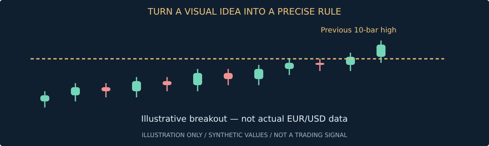

*شکل 27 — نمودار یا طرح توضیحی با اعداد و وضعیت‌های فرضی؛ نه داده بازار و نه اسکرین‌شات نرم‌افزار. برچسب‌های فنی داخل شکل انگلیسی‌اند.*

### مراحل عملی

1. قواعد را قبل از دیدن نتیجه نسخه‌دار کن.
2. کندل جاری را از سقف گذشته حذف کن.
3. اگر قیمت گپ زد، ورود و توقف را با سیاست ازقبل‌نوشته تطبیق بده.
4. شرط رد، خروج و تعارض سفارش را هم تعریف کن.

### تمرین و خروجی قابل بررسی

قواعد بالا را به جدول ورودی/شرط/خروجی تبدیل کن و سه حالت NO_TRADE بنویس.

---

<!-- PAGE 28 -->

<a id="lesson-28"></a>

## درس 28 — افق چنددقیقه‌ای تا چندروزه

**هدف:** برای هر افق استراتژی و هزینه مناسب خودش را بسنجی.

سامانه هدف تو چند افق دارد، اما هر افق باید شناسه، بودجه و ارزیابی جدا داشته باشد. تأخیر ده‌ثانیه‌ای برای معامله چنددقیقه‌ای و معامله سه‌روزه معنای یکسان ندارد. هزینه شبانه، تعطیلی و واکنش به خبر هم در افق‌های مختلف اثر متفاوت دارند.

پایلوت را از یک افق چندساعته شروع کن تا مراحل داده و اجرا تثبیت شوند. سپس استراتژی کوتاه‌تر و حداکثر چهارروزه را جدا در دمو فعال کن. چند استراتژی روی یک نماد ممکن است هم‌زمان خلاف هم تصمیم بگیرند؛ مدیر مرکزی باید تعارض و مالکیت موقعیت را حل کند. ساخت چند ربات بدون این مدیر، تنوع کنترل‌شده ایجاد نمی‌کند.

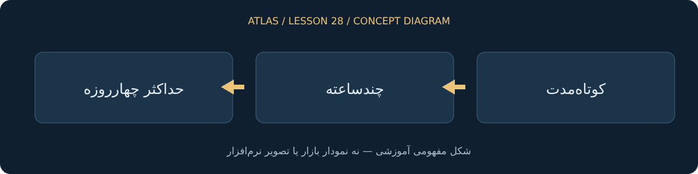

*شکل 28 — شکل مفهومی اختصاصی این درس؛ از راست به چپ بخوانید. این تصویر اسکرین‌شات نرم‌افزار نیست.*

### مراحل عملی

1. برای هر افق بودجه و زمان خروج مشخص کن.
2. داده و تأخیر مناسب همان افق را تهیه کن.
3. هزینه نگهداری و تعطیلی را اضافه کن.
4. تعارض پیشنهادهای هم‌زمان را با سیاست ثابت حل کن.

### تمرین و خروجی قابل بررسی

دو پیشنهاد مخالف روی EUR/USD بساز؛ مشخص کن رد، خالص‌سازی یا اولویت‌بندی چه اثری بر ژورنال دارد.

---

<!-- PAGE 29 -->

<a id="lesson-29"></a>

## درس 29 — حد ضرر، هدف و خروج زمانی

**هدف:** پیش از ورود بدانی معامله چگونه تمام می‌شود.

توقف قیمت، هدف سود و زمان خروج سه قاعده مستقل‌اند. توقف باید با واحد و نوع سفارش روشن باشد. برخی سفارش‌ها در سمت bid و برخی در ask فعال می‌شوند؛ رفتار دقیق را از پلتفرم بخوان. توقف ذهنی یا شرطی که فقط داخل ربات است، در قطعی ربات ممکن است اجرا نشود.

اگر هدف و توقف در یک کندل لمس شوند، داده OHLC ترتیب را نمی‌گوید. استفاده همیشگی از نتیجه بهتر، خطای خوش‌بینی است. داده ریزتر یا فرض محافظه‌کارانه لازم است. خروج زمانی هم هنگام تعطیلی باید سیاست اولین قیمت قابل‌اجرا یا تصمیم ازپیش‌تعریف‌شده داشته باشد.

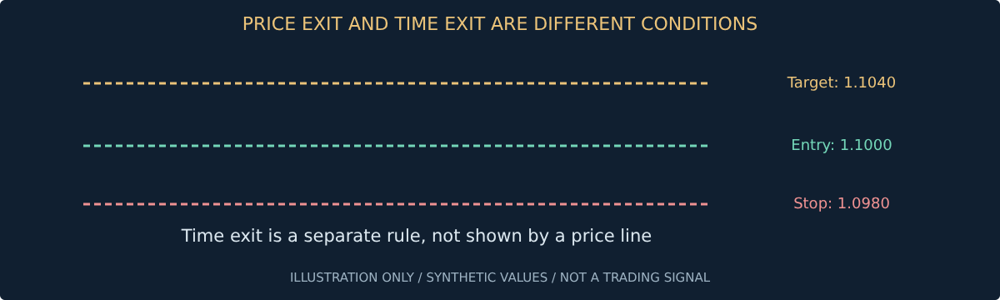

*شکل 29 — نمودار یا طرح توضیحی با اعداد و وضعیت‌های فرضی؛ نه داده بازار و نه اسکرین‌شات نرم‌افزار. برچسب‌های فنی داخل شکل انگلیسی‌اند.*

### مراحل عملی

1. قیمت فعال‌سازی و نوع سفارش توقف را ثبت کن.
2. زمان حداکثر نگهداری را با UTC ذخیره کن.
3. گپ و لمس هم‌زمان هدف/توقف را تست کن.
4. وجود سفارش حفاظتی را بعد از اجرا تأیید کن.

### تمرین و خروجی قابل بررسی

کندلی با High بالای هدف و Low زیر توقف رسم کن؛ توضیح بده چرا از OHLC نمی‌توان نتیجه قطعی گرفت.

---

<!-- PAGE 30 -->

<a id="lesson-30"></a>

## درس 30 — محاسبه حجم: مثال اجرایی در نوت‌بوک

**هدف:** بودجه زیان و سقف مواجهه را هم‌زمان رعایت کنی.

در تصویر واقعی، حساب فرضی ۱۰۰۰دلاری و بودجه ریسک ۰٫۲۵٪ یعنی ۲٫۵ دلار است. ورود ۱٫۱۰۰۰، توقف ۱٫۰۹۸۰ و هزینه تخمینی هر واحد ۰٫۰۰۰۲ دلار است. حجم مبتنی بر توقف حدود ۱۱۳۶ واحد می‌شود، اما سقف بدون اهرم حجم را به ۹۰۸ واحد کاهش می‌دهد؛ زیان تخمینی حدود ۱٫۹۹۷۶ دلار است.

فرمول برای خرید، واحد یورو و حساب دلاری ساده شده است. هزینه ثابت، تأمین مالی و تبدیل ارز جدا لازم‌اند. سقف زیان برنامه‌ریزی‌شده تضمین نیست؛ شکاف قیمت و اجرای بدتر می‌تواند آن را بشکند. گام و حداقل واقعی ابزار باید جای فرض یک واحد بیایند.

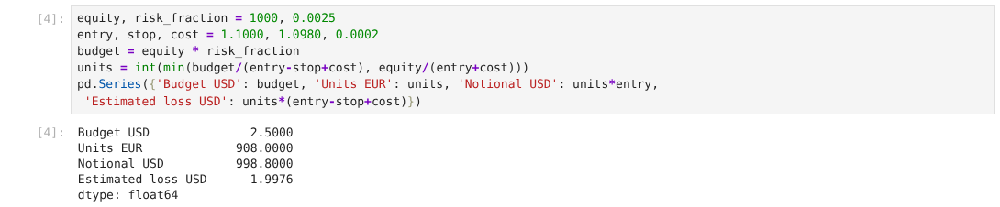

*شکل 30 — اسکرین‌شات واقعی JupyterLab؛ داده و نتیجه ساختگی آموزشی، بدون اتصال کارگزار. مقادیر ورودی بالا و بودجه و حجم محاسبه‌شده در خروجی‌اند.*

### مراحل عملی

1. بودجه را سرمایه ضربدر درصد ریسک حساب کن.
2. هزینه هر واحد را با فاصله توقف جمع کن.
3. حجم را با سقف مواجهه محدود و رو به پایین گرد کن.
4. حداقل مجاز را چک کن؛ در صورت نقض رد کن.

### تمرین و خروجی قابل بررسی

هزینه هر واحد را دو برابر کن و حجم جدید را به دست بیاور؛ ببین کدام سقف فعال است.

---

<!-- PAGE 31 -->

<a id="lesson-31"></a>

## درس 31 — سقف ریسک حساب و همبستگی

**هدف:** جمع چند پیشنهاد، ریسک پنهان نسازد.

ریسک هر معامله به‌تنهایی کافی نیست. چند ربات می‌توانند هم‌زمان علیه دلار موقعیت بگیرند یا روی دارایی‌های همبسته خرید کنند. نام‌های متفاوت همیشه تنوع نیستند. علاوه بر ریسک توقف، مواجهه ارز، جهت و گروه دارایی را جمع کن.

نمونه سیاست آموزشی: یک موقعیت باز در پایلوت، ریسک برنامه‌ریزی‌شده ۰٫۲۵٪ و توقف ورود جدید پس از زیان روزانه ۰٫۷۵٪ با لحاظ زیان باز. این اعداد نسخه عمومی برای همه حساب‌ها نیستند. حدود باید پیش از آزمایش ثبت و مستقل از مدل اجرا شوند؛ بازنشانی روز هم باید منطقه زمانی مشخص داشته باشد.

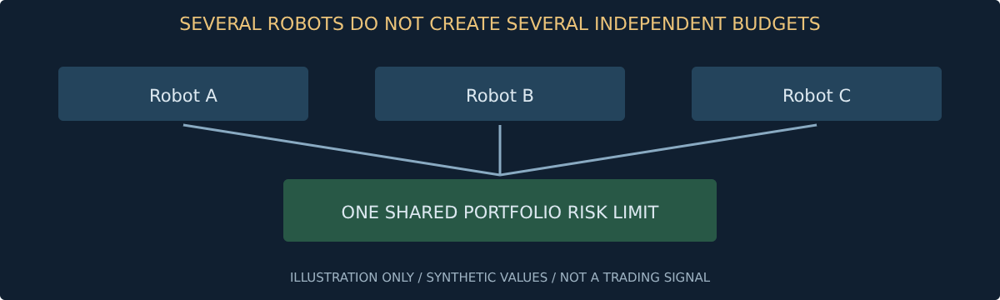

*شکل 31 — نمودار یا طرح توضیحی با اعداد و وضعیت‌های فرضی؛ نه داده بازار و نه اسکرین‌شات نرم‌افزار. برچسب‌های فنی داخل شکل انگلیسی‌اند.*

### مراحل عملی

1. ریسک باز و سفارش‌های معلق را با هم ببین.
2. مواجهه مشترک دلار و گروه دارایی را گزارش کن.
3. سقف تعداد، ارزش مواجهه و زیان روزانه را جدا اعمال کن.
4. مدل اجازه افزایش سقف برای جبران باخت نداشته باشد.

### تمرین و خروجی قابل بررسی

دو معامله هرکدام با بودجه ۰٫۲۵٪ طراحی کن؛ توضیح بده چرا توقف هر دو در یک خبر باید سناریوی مشترک باشد.

---

<!-- PAGE 32 -->

<a id="lesson-32"></a>

## درس 32 — حالت عدم معامله و توقف ایمن

**هدف:** NO_TRADE یک تصمیم سالم و قابل‌گزارش باشد.

اگر شواهد کافی نیست، داده قدیمی است یا هزینه از حد می‌گذرد، سیستم باید پیشنهاد را رد کند. رباتی که همیشه مجبور به معامله است، هدف حفظ سرمایه را نقض می‌کند. علت رد را ساختاریافته ذخیره کن تا بعداً ببینی مشکل از کیفیت داده است یا سخت‌گیری بیش از حد قواعد.

عدم معامله با خروج از موقعیت باز فرق دارد. در خرابی ورودی، شاید ورود جدید باید متوقف شود ولی سفارش حفاظتی معتبر باقی بماند. سیاست را برحسب شدت خطا تعریف کن؛ بستن کورکورانه همه موقعیت‌ها نیز می‌تواند هزینه و ریسک ایجاد کند. تصمیم اضطراری نیازمند برنامه آزموده‌شده است.

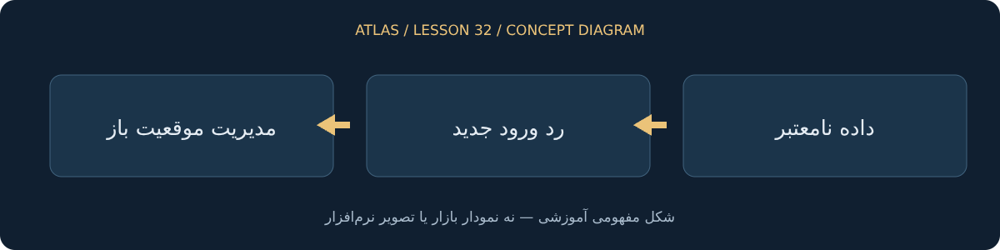

*شکل 32 — شکل مفهومی اختصاصی این درس؛ از راست به چپ بخوانید. این تصویر اسکرین‌شات نرم‌افزار نیست.*

### مراحل عملی

1. کدهای رد مثل STALE_DATA و HIGH_SPREAD تعریف کن.
2. توقف ورود را از لغو و خروج جدا کن.
3. هشدار خطا را مستقل از ربات اجرا کن.
4. بازگشت از حالت توقف را به بررسی سلامت مشروط کن.

### تمرین و خروجی قابل بررسی

پنج وضعیت رد بنویس؛ برای هرکدام تعیین کن موقعیت باز چگونه مدیریت می‌شود.

---

<!-- PAGE 33 -->

<a id="lesson-33"></a>

## درس 33 — Market، Limit و Stop

**هدف:** نوع سفارش را با تضمین قیمت یا اجرا اشتباه نگیری.

Market قصد اجرای فوری با نقدشوندگی موجود دارد، نه قیمت دقیق نمایش‌داده‌شده. Limit سقف خرید یا کف فروش را محدود می‌کند ولی ممکن است هرگز پر نشود. Stop پس از فعال‌شدن بر اساس نوع تعریف‌شده عمل می‌کند و می‌تواند با قیمت متفاوت اجرا شود. جزئیات هر پلتفرم را جدا بخوان.

برای استراتژی، انتخاب نوع سفارش بخشی از فرضیه است؛ تغییر آن پس از دیدن نتیجه هزینه و احتمال اجرا را عوض می‌کند. بک‌تستی که Limit را با هر لمس قیمت حتماً پرشده فرض کند، ممکن است صف و عمق بازار را نادیده بگیرد. نسخه اول باید فرض پرشدن را صریح ثبت کند.


*شکل 33 — شکل مفهومی اختصاصی این درس؛ از راست به چپ بخوانید. این تصویر اسکرین‌شات نرم‌افزار نیست.*

### مراحل عملی

1. هدف سفارش، محدودیت قیمت و مدت اعتبار را ثبت کن.
2. برای عدم پرشدن برنامه لغو یا انقضا داشته باش.
3. پرشدن جزئی را با حجم واقعی مدیریت کن.
4. رفتار سفارش حفاظتی وابسته را در دمو تست کن.

### تمرین و خروجی قابل بررسی

یک Limit پرنشده تا پایان اعتبار را به حالت EXPIRED ببر؛ بررسی کن پوزیشن خیالی ایجاد نشود.

---

<!-- PAGE 34 -->

<a id="lesson-34"></a>

## درس 34 — چرخه عمر سفارش و شناسه یکتا

**هدف:** قطع پاسخ باعث سفارش تکراری نشود.

ارسال سفارش و گرفتن پاسخ دو رویداد جدا هستند. ممکن است درخواست به کارگزار رسیده ولی پاسخ شبکه گم شده باشد. در این حالت ارسال دوباره بدون استعلام می‌تواند موقعیت را دو برابر کند. client_order_id یکتا، ثبت پیش از ارسال و تطبیق با وضعیت کارگزار لازم‌اند.

حالت‌های نمونه شامل CREATED،SENT،ACKNOWLEDGED،PARTIAL،FILLED،CANCELED،REJECTED و UNKNOWN هستند. حالت UNKNOWN را به FILLED یا REJECTED حدس نزن. ورود جدید را تا حل ابهام محدود کن. اطلاعات کارگزار مرجع وضعیت اجراست؛ برنامه باید اختلاف با وضعیت محلی را گزارش کند، نه پنهان.

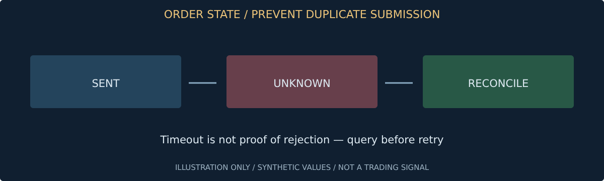

*شکل 34 — نمودار یا طرح توضیحی با اعداد و وضعیت‌های فرضی؛ نه داده بازار و نه اسکرین‌شات نرم‌افزار. برچسب‌های فنی داخل شکل انگلیسی‌اند.*

### مراحل عملی

1. شناسه تصمیم را به شناسه سفارش مرتبط کن.
2. قبل از ارسال، وضعیت پایدار ذخیره کن.
3. در timeout، اول استعلام و تطبیق کن.
4. تغییر وضعیت‌ها را افزایشی و قابل‌ردیابی ثبت کن.

### تمرین و خروجی قابل بررسی

سناریوی «پاسخ گم شد ولی سفارش اجرا شد» را شبیه‌سازی کن؛ فقط یک سفارش باید در حساب وجود داشته باشد.

---

<!-- PAGE 35 -->

<a id="lesson-35"></a>

## درس 35 — حساب دمو و محدودیت شبیه‌سازی

**هدف:** دمو را آزمایش عملیات بدانی، نه تضمین اجرای واقعی.

دمو برای بررسی API، حجم، نوع سفارش و ثبت وضعیت ارزشمند است؛ اما عمق، لغزش، صف و فشار واقعی را لزوماً بازنمایی نمی‌کند. تفاوت نتیجه دمو و فرض بک‌تست باید اندازه‌گیری شود. نتیجه خوب چند روز دمو شواهد کافی برای فعال‌کردن پول واقعی نیست.

در هر راه‌اندازی، نام حساب و حالت اجرا را روی صفحه و گزارش برجسته کن. فایل تنظیمات دمو و واقعی جدا باشد و پیش‌فرض همیشه امن. این مخزن به هیچ حسابی متصل نیست؛ پنل‌های کتاب دستورالعمل پژوهش هستند. اسکرین‌شات واقعی منوهای کارگزار بعد از انتخاب و دسترسی مجاز باید جدا اضافه شود.

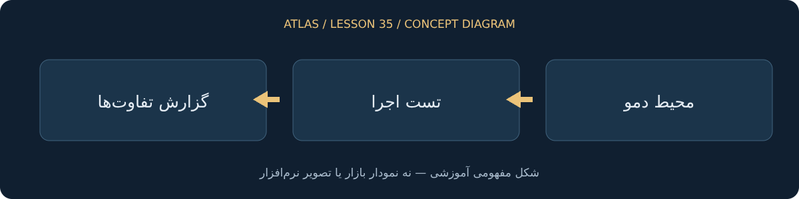

*شکل 35 — شکل مفهومی اختصاصی این درس؛ از راست به چپ بخوانید. این تصویر اسکرین‌شات نرم‌افزار نیست.*

### مراحل عملی

1. شناسه حساب و محیط را قبل از هر جلسه بررسی کن.
2. سفارش بسیار محدود و سناریوهای رد را در دمو تست کن.
3. اجرای توقف، انقضا و پرشدن جزئی را ثبت کن.
4. معیار عبور را از قبل بنویس؛ تاریخ تقویمی به‌تنهایی کافی نیست.

### تمرین و خروجی قابل بررسی

چک‌لیستی بساز که نبود برچسب DEMO در آن باعث توقف راه‌اندازی شود.

---

<!-- PAGE 36 -->

<a id="lesson-36"></a>

## درس 36 — خواندن گزارش واقعی Backtesting.py

**هدف:** اجزای گزارش را بشناسی و دامنه اعتبارش را محدود کنی.

تصویر از نرم‌افزار واقعی Backtesting.py با رسم Bokeh گرفته شده است. نوار بالا سرمایه شبیه‌سازی‌شده، بخش میانی نتیجه معاملات و بخش اصلی قیمت ساختگی و مسیر معاملات را نشان می‌دهد. ابزارهای کنار نمودار برای جابه‌جایی و بزرگ‌نمایی‌اند. فایل HTML تعاملی همین گزارش در پیوست نرم‌افزار موجود است.

این گزارش با داده ساختگی، حجم ثابت و قواعد نمایشی ساخته شده؛ تقویم واقعی، swaps و اجرای حساب واقعی را ندارد. نتیجه‌اش تأیید یا رد استراتژی بازار نیست. عمداً برچسب SYNTHETIC روی صفحه درج شده تا واقعی‌بودن اسکرین‌شات با واقعی‌بودن داده اشتباه نشود. مستندات ابزار را پیش از استفاده پژوهشی بخوان [S4](https://kernc.github.io/backtesting.py/).

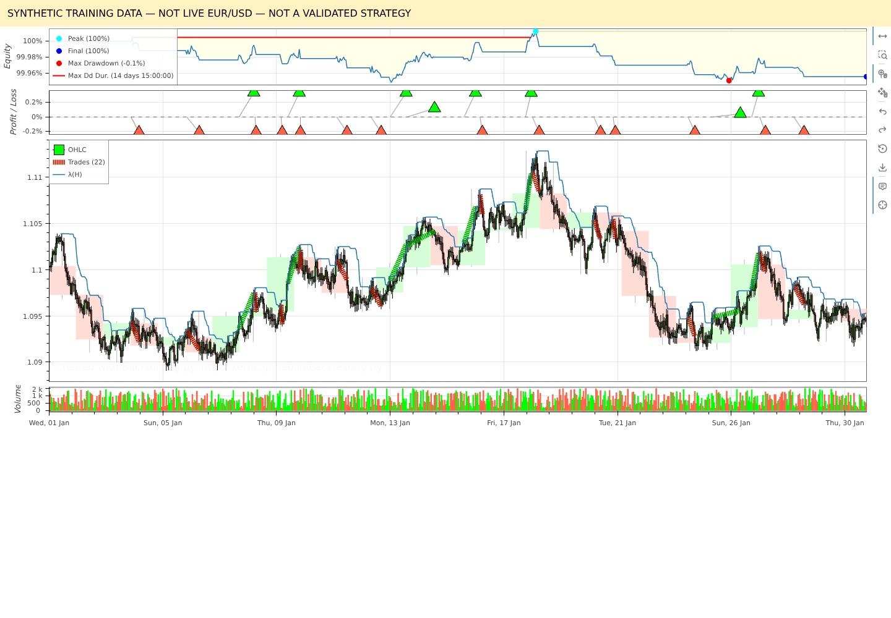

*شکل 36 — اسکرین‌شات واقعی Backtesting.py / Bokeh؛ داده و نتیجه ساختگی آموزشی، بدون اتصال کارگزار. بالا منحنی سرمایه؛ پایین قیمت و مسیر معاملات؛ ابزار زوم در راست.*

### مراحل عملی

1. گزارش محلی را باز و هشدار بالای آن را بخوان.
2. نمودار قیمت و سرمایه را از هم تشخیص بده.
3. روی بخشی از نمودار زوم کن.
4. یک معامله را با سطر متناظر CSV تطبیق بده.

### تمرین و خروجی قابل بررسی

یک معامله زیان‌ده در فایل synthetic_trades.csv پیدا کن و زمان و قیمتش را در گزارش بررسی کن.

---

<!-- PAGE 37 -->

<a id="lesson-37"></a>

## درس 37 — ژورنال تصمیم و اجرای معامله

**هدف:** دلیل هر نتیجه را از داده تا سفارش بازیابی کنی.

ژورنال فقط فهرست سود و زیان نیست. باید نشان دهد مدل چه منابعی دیده، چه پیشنهادی داده، ریسک چرا پذیرفته یا رد کرده و کارگزار چه چیزی اجرا کرده است. شناسه‌ها باید پیوند داده، رویداد و سفارش را حفظ کنند. موقعیت بسته‌شده بدون دلیل خروج، برای یادگیری ناقص است.

در اسکرین‌شات واقعی JupyterLab، جدول معاملات شبیه‌سازی‌شده از CSV خوانده شده است. این جدول بخش کوچکی از ژورنال نهایی است و داده واقعی حساب نیست. متن آزاد برای یادداشت خوب است، ولی فیلدهای کلیدی ساختاریافته باشند تا بتوان خطا و هزینه را در گزارش‌ها جمع کرد.

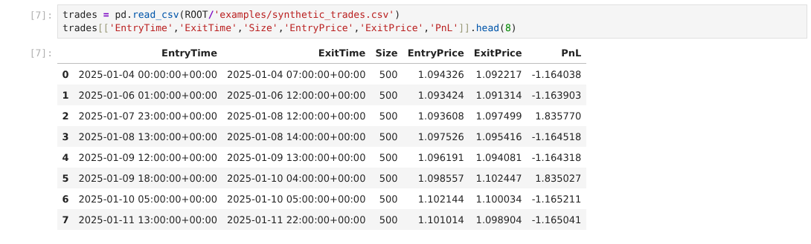

*شکل 37 — اسکرین‌شات واقعی JupyterLab؛ داده و نتیجه ساختگی آموزشی، بدون اتصال کارگزار. جدول خروجی شامل زمان، حجم، قیمت و سود/زیان شبیه‌سازی است.*

### مراحل عملی

1. زمان تصمیم، ارسال، تأیید و اجرا را جدا ثبت کن.
2. قیمت برنامه و قیمت واقعی را نگه دار.
3. علت رد و خروج را با کد ذخیره کن.
4. اطلاعات شخصی و کلید را از متن خطا و تصویر حذف کن.

### تمرین و خروجی قابل بررسی

یک تصمیم NO_TRADE و یک سفارش ردشده هم وارد ژورنال کن؛ نباید فقط معاملات موفق ثبت شوند.

---

<!-- PAGE 38 -->

<a id="lesson-38"></a>

## درس 38 — کلیدها، مجوزها و امنیت نرم‌افزار

**هدف:** یک خطای تحلیل نتواند برداشت یا کنترل کامل حساب را ایجاد کند.

کلید پژوهش، داده و اجرا را در صورت امکان تفکیک کن. دسترسی برداشت برای ربات معاملاتی لازم نیست. محدودیت IP، انقضا و چرخش کلید در صورت پشتیبانی مفیدند؛ اما جای کنترل دسترسی داخل برنامه را نمی‌گیرند. هیچ اعتبارنامه‌ای وارد مدل خبری یا پرامپت عمومی نشود.

نوت‌بوک هم برنامه قابل‌اجراست؛ ممکن است فایل بخواند یا شبکه را فراخوانی کند. قبل از اجرای نمونه‌های اینترنتی، کد را بررسی کن. عکس صفحه می‌تواند توکن، شناسه حساب یا مسیر حساس داشته باشد. اگر کلیدی افشا شد، صرف پاک‌کردن تصویر کافی نیست؛ کلید باید باطل و جایگزین شود.

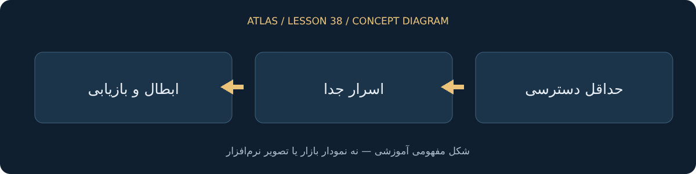

*شکل 38 — شکل مفهومی اختصاصی این درس؛ از راست به چپ بخوانید. این تصویر اسکرین‌شات نرم‌افزار نیست.*

### مراحل عملی

1. حداقل مجوز لازم را برای هر سرویس فهرست کن.
2. secretها را خارج از گیت و گزارش نگه دار.
3. وابستگی و نسخه را بررسی و به‌روزرسانی کنترل‌شده کن.
4. سناریوی افشای کلید و بازیابی را مستند کن.

### تمرین و خروجی قابل بررسی

اسکرین‌شات فرضی دارای توکن را شناسایی کن و مراحل واکنش، از ابطال تا بازبینی لاگ را بنویس.

---

<!-- PAGE 39 -->

<a id="lesson-39"></a>

## درس 39 — پایش سلامت و کلید توقف

**هدف:** خرابی خود ربات هم قابل‌تشخیص باشد.

اگر همان برنامه‌ای که معامله می‌کند مسئول تنها هشدار سلامت باشد، خاموش‌شدن آن ممکن است بی‌صدا بماند. heartbeat و ناظر مستقل لازم است. کیفیت داده، تأخیر، صف خبر، خطای مدل، وضعیت API و اختلاف موجودی را پایش کن. آستانه‌ها باید با داده واقعی عملکرد سیستم تعیین شوند.

کلید توقف یک دکمه مبهم نیست. حالت اول ورود جدید را می‌بندد؛ حالت دوم سفارش‌های معلق را مدیریت می‌کند؛ حالت سوم خروج اضطراری را طبق سیاست اجرا می‌کند. هر حالت هزینه و خطر خودش را دارد. موقعیت باز حتی هنگام توقف تحلیل نیازمند حفاظت و تطبیق است. مسیر هشدار انسانی را هم از قبل تعیین کن.

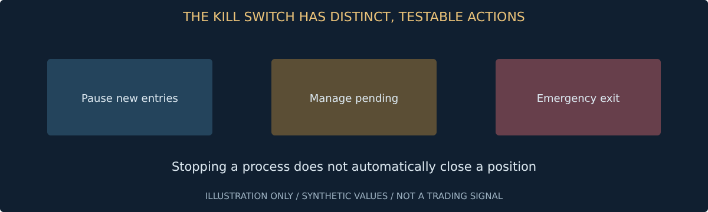

*شکل 39 — نمودار یا طرح توضیحی با اعداد و وضعیت‌های فرضی؛ نه داده بازار و نه اسکرین‌شات نرم‌افزار. برچسب‌های فنی داخل شکل انگلیسی‌اند.*

### مراحل عملی

1. برای هر سرویس heartbeat و timeout تعریف کن.
2. هشدار را از مسیر مستقل ارسال کن.
3. در restart ابتدا حساب را تطبیق بده.
4. بازگشت خودکار به معامله را به آزمون سلامت مشروط کن.

### تمرین و خروجی قابل بررسی

ربات را عمداً متوقف کن و زمان رسیدن هشدار را بسنج؛ خروجی را با هدف عملیاتی مقایسه کن.

---

<!-- PAGE 40 -->

<a id="lesson-40"></a>

## درس 40 — تست واحد و آزمون خرابی

**هدف:** قبل از آزمایش سود، صحت رفتار پایه را ثابت کنی.

تست حجم باید نشان دهد توقف نامعتبر رد می‌شود، گام حجم رعایت می‌شود و سقف مواجهه نقض نمی‌شود. تست داده باید زمان تکراری و OHLC غلط را بگیرد. تست اجرا باید پاسخ مبهم و سفارش تکراری را پوشش دهد. سودآوری احتمالی جای این تست‌ها را نمی‌گیرد.

این مخزن تست ساده ماشین‌حساب و ساختار سند دارد؛ آن‌ها تست ربات اجرایی نیستند. برای نرم‌افزار آینده، ورودی و خروجی هر ماژول را با داده ساختگی ثابت بررسی کن و سرویس بیرونی را mock کن. سپس تست یکپارچه دمو اضافه شود. هر باگ عملیاتی باید یک تست بازگشت خطا بسازد.

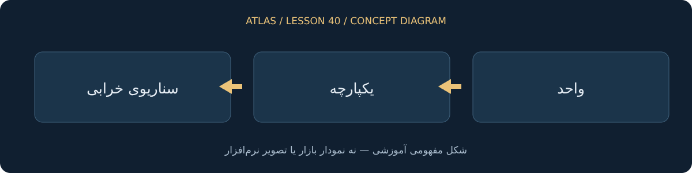

*شکل 40 — شکل مفهومی اختصاصی این درس؛ از راست به چپ بخوانید. این تصویر اسکرین‌شات نرم‌افزار نیست.*

### مراحل عملی

1. حالت عادی، مرزی و خطای هر تابع را بنویس.
2. اعداد NaN، حجم صفر و هزینه منفی را تست کن.
3. قطع اتصال و پاسخ تکراری را شبیه‌سازی کن.
4. تست‌ها را پیش از هر تغییر مدل اجرا کن.

```text
node tests/calculator.test.js
python tests/check_document.py
python tests/check_book.py
```

### تمرین و خروجی قابل بررسی

یک تست برای حجم کمتر از حداقل و یک تست برای سفارش ارسال‌شده با پاسخ گم‌شده بنویس.

---

<!-- PAGE 41 -->

<a id="lesson-41"></a>

## درس 41 — بک‌تست معتبر و فرض‌های اجرا

**هدف:** موتور شبیه‌سازی را با بازار واقعی اشتباه نگیری.

بک‌تست قوانین را روی داده گذشته بازپخش می‌کند، اما نتیجه تابع کیفیت داده و فرض‌های اجراست. قیمت ورود، ترتیب خروج، کارمزد، اسپرد، گپ، تعطیلی و نگهداری باید مشخص باشند. بک‌تست مبتنی بر OHLC همه جزئیات مسیر قیمت و صف سفارش را نمی‌داند.

برای پژوهش از ابزار مستند مثل Backtesting.py می‌توان استفاده کرد [S4](https://kernc.github.io/backtesting.py/)، اما هیچ موتور عمومی خودکار همه ویژگی‌های قرارداد تو را مدل نمی‌کند. تفاوت بین هزینه درصدی، هزینه ثابت و هزینه شبانه را بررسی کن. گزارش باید کنار اعداد، فهرست محدودیت‌ها داشته باشد. اگر یک فرض مهم نامعلوم است، نتیجه را مشروط اعلام کن.

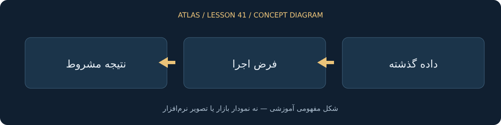

*شکل 41 — شکل مفهومی اختصاصی این درس؛ از راست به چپ بخوانید. این تصویر اسکرین‌شات نرم‌افزار نیست.*

### مراحل عملی

1. فرض‌ها را در فایل config و گزارش بنویس.
2. ورود را زودتر از دسترسی داده اجرا نکن.
3. برای گپ و تعارض توقف/هدف فرض محافظه‌کارانه داشته باش.
4. نتیجه چند معامله را دستی تطبیق بده.

### تمرین و خروجی قابل بررسی

سه معامله را روی کاغذ با هزینه محاسبه و با خروجی موتور مقایسه کن؛ اختلاف را توضیح بده.

---

<!-- PAGE 42 -->

<a id="lesson-42"></a>

## درس 42 — تقسیم زمانی و Walk-forward

**هدف:** آزمون را از تنظیم مکرر پارامترها جدا نگه داری.

داده زمان‌دار را برای آموزش و آزمون به‌صورت تصادفی مخلوط نکن؛ اطلاعات آینده و برچسب‌های همپوشان می‌توانند نشت ایجاد کنند. بازه قدیمی برای طراحی، بازه بعدی برای اعتبارسنجی و بازه نهایی دست‌نخورده برای آزمون نگه دار. برازش مقیاس‌گذار و انتخاب ویژگی هم داخل آموزش انجام شوند.

در Walk-forward، هر دور فقط از گذشته آموزش می‌بیند و روی بازه بعدی ارزیابی می‌شود. طول پنجره باید با داده و افق نگهداری سازگار باشد. آزمونی که بعد از دیدن نتیجه‌اش دوباره قواعد را تنظیم کردی، دیگر آزمون نهایی دست‌نخورده نیست. تعداد آزمایش‌ها را هم ثبت کن.

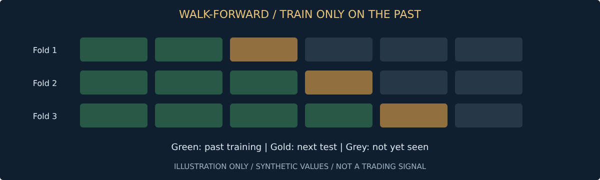

*شکل 42 — نمودار یا طرح توضیحی با اعداد و وضعیت‌های فرضی؛ نه داده بازار و نه اسکرین‌شات نرم‌افزار. برچسب‌های فنی داخل شکل انگلیسی‌اند.*

### مراحل عملی

1. بازه‌ها را پیش از آموزش ثابت کن.
2. همپوشانی برچسب‌ها را حذف یا فاصله مناسب بگذار.
3. تبدیل ویژگی را فقط روی آموزش fit کن.
4. نتیجه همه دورها را گزارش کن، نه بهترین دور.

### تمرین و خروجی قابل بررسی

برای افق چهارروزه، مرز دو بخش را رسم کن و نشان بده کدام برچسب‌ها وارد بخش بعدی می‌شوند.

---

<!-- PAGE 43 -->

<a id="lesson-43"></a>

## درس 43 — نشت داده در مدل خبری و زبانی

**هدف:** دانش تاریخی مدل، آزمون گذشته را آلوده نکند.

مدل زبانی امروزی ممکن است رویداد قدیمی و نتیجه بازار پس از آن را در آموزش دیده باشد. حتی اگر فقط متن اولیه خبر را به آن بدهی، بازپخش تاریخی خودبه‌خود آزمون پاک نیست. دسترسی مدل به تاریخ، نام رویداد یا جست‌وجوی امروز می‌تواند اطلاعات بعدی را وارد تحلیل کند.

داده اصلاح‌شده، خبر ویرایش‌شده و شاخص‌های محاسبه‌شده روی کل مجموعه هم منابع نشت‌اند. تا حد امکان snapshot زمان‌دار داشته باش، ورودی را محدود کن و آزمون روبه‌جلو روی رویدادهای جدید را جدی بگیر. هیچ روش ساده‌ای همه نشت‌های دانش مدل را تضمینی حذف نمی‌کند؛ محدودیت را در گزارش صریح بنویس.

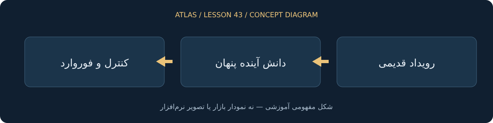

*شکل 43 — شکل مفهومی اختصاصی این درس؛ از راست به چپ بخوانید. این تصویر اسکرین‌شات نرم‌افزار نیست.*

### مراحل عملی

1. تاریخ نسخه مدل و حدود دانش را ثبت کن.
2. جست‌وجوی امروزی را در بازپخش قدیمی بی‌قید فعال نکن.
3. نسخه نخست خبر و زمان دریافت را نگه دار.
4. کارایی بیرون‌نمونه و فوروارد را جدا گزارش کن.

### تمرین و خروجی قابل بررسی

دو مسیر نشت غیرقیمتی بنویس؛ یکی از طریق خبر اصلاح‌شده و یکی از طریق دانش مدل.

---

<!-- PAGE 44 -->

<a id="lesson-44"></a>

## درس 44 — معیارهای عملکرد: فراتر از درصد برد

**هدف:** نتیجه را با هزینه، افت سرمایه و تعداد شواهد بخوانی.

در اسکرین‌شات واقعی، خلاصه نمونه ساختگی از فایل JSON خوانده شده است. عدد Return یا Win Rate بدون تعداد معاملات، اندازه زیان و فرض هزینه کافی نیست. یک معامله بزرگ می‌تواند کل نتیجه را تغییر دهد. نمودار سرمایه با زیان باز هم لازم است، نه فقط موجودی پس از بستن معاملات.

امید ریاضی نمونه: برد ۴۰٪ با میانگین برد ۲R و باخت ۱R، قبل از هزینه ۰٫۲R است. اگر متوسط هزینه ۰٫۲۵R باشد، خالص منفی ۰٫۰۵R می‌شود. افت سرمایه، طول بازیابی، ثبات دوره‌ها و خطاهای عملیاتی باید کنار بازده بیایند. نمونه کوچک، عدم‌قطعیت زیاد دارد.

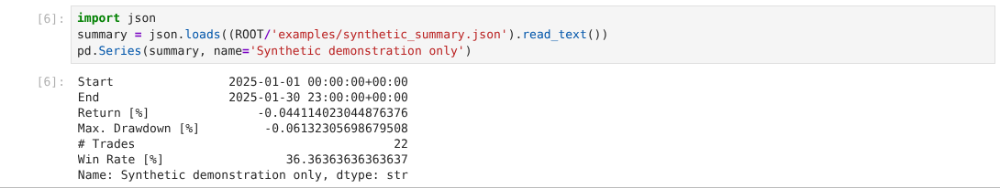

*شکل 44 — اسکرین‌شات واقعی JupyterLab؛ داده و نتیجه ساختگی آموزشی، بدون اتصال کارگزار. خلاصه نمایش داده می‌شود؛ این اعداد عملکرد بازار واقعی نیستند.*

### مراحل عملی

1. بازده خالص و بیشترین افت را گزارش کن.
2. مدت بازیابی و توزیع سود/زیان را بررسی کن.
3. تعداد، تمرکز و هزینه معاملات را اضافه کن.
4. اعداد دمو و واقعی و ساختگی را مخلوط نکن.

### تمرین و خروجی قابل بررسی

با نرخ برد ۶۰٪، برد متوسط ۰٫۵R و باخت ۱R، امید ناخالص را حساب کن؛ پاسخ: منفی ۰٫۱R.

---

<!-- PAGE 45 -->

<a id="lesson-45"></a>

## درس 45 — تست حساسیت هزینه و تأخیر

**هدف:** مزیت شکننده را قبل از پول واقعی شناسایی کنی.

یک سیستم ممکن است فقط با هزینه خوش‌بینانه یا اجرای فوری سود نشان دهد. هزینه رفت‌وبرگشت را افزایش بده، ورود را عقب بینداز و پارامترها را کمی تغییر بده. هدف پیدا کردن زیباترین ترکیب نیست؛ تشخیص وابستگی نتیجه به فرض‌های غیرواقعی است.

برای افق چنددقیقه‌ای، تأخیر دریافت خبر و پاسخ مدل اهمیت ویژه دارد. برای نگهداری چندروزه، هزینه شبانه و شکاف بازگشایی را بررسی کن. تست فشار جای داده واقعی را نمی‌گیرد، اما می‌تواند فرضیه ضعیف را زودتر رد کند. محدوده فشار و معیار رد را قبل از دیدن نتیجه مشخص کن.

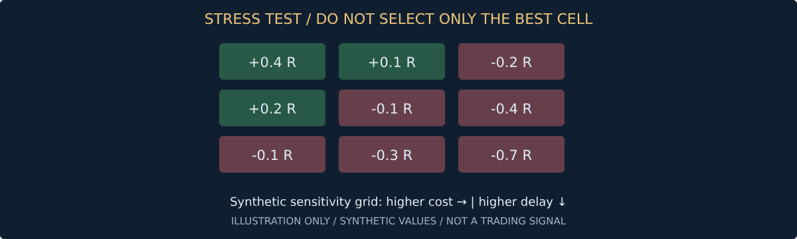

*شکل 45 — نمودار یا طرح توضیحی با اعداد و وضعیت‌های فرضی؛ نه داده بازار و نه اسکرین‌شات نرم‌افزار. برچسب‌های فنی داخل شکل انگلیسی‌اند.*

### مراحل عملی

1. سناریوی پایه، هزینه دوبرابر و تأخیر بیشتر بساز.
2. افت سرمایه و خالص همه سناریوها را کنار هم بگذار.
3. حساسیت نزدیک پارامتر را بررسی کن.
4. دوره‌های شکست را حذف نکن؛ علت را ثبت کن.

### تمرین و خروجی قابل بررسی

یک جدول ۳×۳ برای هزینه و تأخیر بساز؛ تعیین کن کدام الگو را نشانه شکنندگی می‌دانی.

---

<!-- PAGE 46 -->

<a id="lesson-46"></a>

## درس 46 — فورواردتست و معیار عبور

**هدف:** گذشت چند هفته را با اثبات آمادگی یکی نگیری.

فورواردتست یعنی اجرای قواعد ثابت روی داده تازه بدون استفاده از آینده. ابتدا حالت مشاهده، سپس اجرای دمو و تطبیق هزینه. مدت کافی تابع تعداد و تنوع شرایط است؛ یک پایان تقویمی یا چند برد متوالی مجوز فعال‌کردن پول واقعی نیست.

قبل از شروع، معیارهای کیفیت داده، خطا، افت سرمایه و تفاوت اجرا را بنویس. معیارها پس از زیان نباید برای عبور آسان‌تر تغییر کنند. اگر استراتژی عوض شد، نسخه جدید آزمایش تازه می‌خواهد. توقف پروژه به دلیل نبود شواهد، شکست بی‌ارزش نیست؛ بخشی از حفظ سرمایه است.

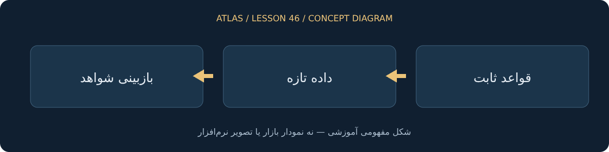

*شکل 46 — شکل مفهومی اختصاصی این درس؛ از راست به چپ بخوانید. این تصویر اسکرین‌شات نرم‌افزار نیست.*

### مراحل عملی

1. نسخه قواعد و تاریخ شروع را قفل کن.
2. علت همه پیشنهادهای ردشده را هم ذخیره کن.
3. هزینه واقعی دمو را با مدل مقایسه کن.
4. گزارش بازبینی انسانی و تصمیم ادامه/رد بساز.

### تمرین و خروجی قابل بررسی

یک برگه پذیرش با پنج معیار و حالت «شواهد ناکافی» بنویس؛ صرفاً قبول یا رد دودویی نباشد.

---

<!-- PAGE 47 -->

<a id="lesson-47"></a>

## درس 47 — عملیات ۲۴ساعته و بازیابی

**هدف:** سامانه در برابر restart و خرابی سرویس مقاوم باشد.

همیشه‌فعال بودن نیازمند صف پایدار، ثبت وضعیت و ناظر بیرونی است. راه‌اندازی مجدد نباید همه چیز را خالی فرض کند؛ شاید موقعیت یا سفارش معلق هنوز در کارگزار وجود داشته باشد. قبل از فعال‌شدن ورود جدید، تطبیق حساب، تقویم و داده لازم است.

محدودیت نرخ API، زمان پاسخ مدل و هزینه فراخوانی هم منابع محدودند. هر خبر را چند بار بی‌دلیل به مدل نفرست؛ cache و شناسه نسخه داشته باش. ترافیک زیاد اجتماعی نباید پردازش خروج حفاظتی را گرسنه نگه دارد. اولویت عملیات حیاتی را جدا از تحلیل کم‌اهمیت طراحی کن.


*شکل 47 — شکل مفهومی اختصاصی این درس؛ از راست به چپ بخوانید. این تصویر اسکرین‌شات نرم‌افزار نیست.*

### مراحل عملی

1. وضعیت تصمیم و سفارش را پایدار ذخیره کن.
2. صف تحلیل را از مسیر مدیریت ریسک جدا کن.
3. در restart ابتدا reconciliation انجام بده.
4. برای قطع طولانی سرویس، برنامه انسانی جایگزین داشته باش.

### تمرین و خروجی قابل بررسی

در میانه سفارش برنامه را خاموش و دوباره روشن کن؛ ثابت کن موقعیت دوباره باز نمی‌شود.

---

<!-- PAGE 48 -->

<a id="lesson-48"></a>

## درس 48 — افزودن طلا، شاخص و سهام

**هدف:** بازار بعدی را با مشخصات مستقل وارد کنی.

رابط مشترک به معنی قرارداد یکسان نیست. در طلا باید واحد اونس و ساختار فیزیکی، ETC، CFD یا آتی مشخص شود. در شاخص، ETF و CFD و آتی رفتار هزینه و سررسید متفاوت دارند. در سهام، سود تقسیمی، تعدیل، توقف نماد و سفارش کسری باید بررسی شوند.

برای بازار دوم ابتدا فقط داده و گزارش اضافه کن؛ اجرای سفارش را پس از آزمون مستقل فعال کن. عملکرد EUR/USD به‌طور خودکار قابل انتقال نیست. محدودیت حساب، دسترسی داده و ساعات معامله ممکن است توسعه را تغییر دهند. دامنه اطلاعات می‌تواند جهانی بماند، اما دامنه اجرا باید با شواهد رشد کند.

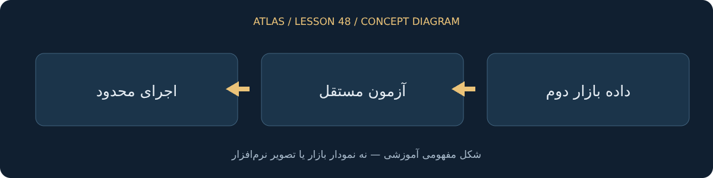

*شکل 48 — شکل مفهومی اختصاصی این درس؛ از راست به چپ بخوانید. این تصویر اسکرین‌شات نرم‌افزار نیست.*

### مراحل عملی

1. برگه مشخصات ابزار جدید را کامل کن.
2. آداپتور داده و تقویم را جدا تست کن.
3. قواعد و هزینه جدید را بیرون‌نمونه بسنج.
4. اثر مواجهه مشترک با بازار اول را بررسی کن.

### تمرین و خروجی قابل بررسی

برای یک ابزار طلا پنج تفاوت با EUR/USD بنویس که باید در کد یا تنظیمات دیده شوند.

---

<!-- PAGE 49 -->

<a id="lesson-49"></a>

## درس 49 — افزودن رمزارز و مدیریت هم‌زمان بازارها

**هدف:** گسترش دامنه، کنترل مرکزی ریسک را دور نزند.

رمزارز می‌تواند تقویم، نگهداری و محدودیت سفارش متفاوتی داشته باشد. در مستندات نمونه Binance، minQty، stepSize و حداقل ارزش معامله جدا تعریف شده‌اند [S5](https://developers.binance.com/docs/binance-spot-api-docs/filters). این ارجاع فنی نه تأیید صرافی برای شماست و نه توصیه استفاده از اهرم.

وقتی چند بازار فعال شدند، بودجه و مواجهه را در یک واحد حساب تجمیع کن. ارز مظنه مانند تتر ریسک مستقل دارد و معادل بی‌قید دلار بانکی نیست. با قطع یک پلتفرم نباید وضعیت بقیه حساب‌ها ناشناخته بماند. مدیر مرکزی باید تعارض و همبستگی را ببیند و اجازه تصمیم هم‌زمان خارج از سقف ندهد.

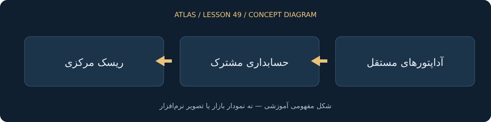

*شکل 49 — شکل مفهومی اختصاصی این درس؛ از راست به چپ بخوانید. این تصویر اسکرین‌شات نرم‌افزار نیست.*

### مراحل عملی

1. حداقل و گام سفارش را از مشخصات همان نماد بخوان.
2. ریسک مظنه و نگهداری را جدا ثبت کن.
3. کل مواجهه حساب‌ها را با تبدیل ارز معتبر جمع کن.
4. توقف یک آداپتور را بدون نابودکردن ثبت سایر بازارها تست کن.

### تمرین و خروجی قابل بررسی

سه ربات با خرید هم‌زمان دارایی‌های وابسته به دلار طراحی کن؛ نشان بده سقف مرکزی کدام را رد می‌کند.

---

<!-- PAGE 50 -->

<a id="lesson-50"></a>

## درس 50 — پروژه نهایی و چک‌لیست تحویل

**هدف:** یک نسخه پژوهشی قابل‌بررسی تحویل بدهی، نه ادعای ربات سودساز.

خروجی پایان این کتاب باید یک مسیر قابل‌بازتولید از داده به پیشنهاد و گزارش باشد. ابتدا خط مبنای بدون AI و سپس ارزش افزوده خبر را نشان بده. اگر داده، هزینه یا دسترسی اجرایی کامل نیست، این محدودیت را کنار نتیجه بنویس. هیچ نتیجه ساختگی یا گزینشی را با سود واقعی مخلوط نکن.

تحویل حرفه‌ای شامل کد بررسی‌شده، تنظیمات بدون اسرار، داده نمونه مجاز، تست، گزارش خطا و راهنمای توقف است. هدف بعدی ساخت ربات زنده فقط بعد از شواهد و بررسی مستقل است. این کتاب و نوت‌بوک همراه خودشان چنین رباتی نیستند و برای معامله با پول واقعی آماده اعلام نشده‌اند.

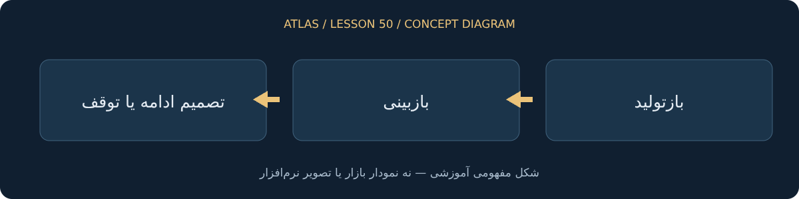

*شکل 50 — شکل مفهومی اختصاصی این درس؛ از راست به چپ بخوانید. این تصویر اسکرین‌شات نرم‌افزار نیست.*

### مراحل عملی

1. برگه ابزار، زمان‌بندی و منابع مجاز را تحویل بده.
2. تست حجم، نشت و سفارش تکراری را اجرا کن.
3. گزارش بیرون‌نمونه و دمو را با محدودیت‌ها ضمیمه کن.
4. مسیر بازیابی، کلید توقف و مسئول بازبینی را مشخص کن.

### تمرین و خروجی قابل بررسی

یک رویداد را از منبع تا NO_TRADE یا سفارش دمو بازسازی کن؛ هر مرحله باید شناسه و دلیل قابل‌بررسی داشته باشد.

---

<!-- PAGE 51 -->

<a id="lesson-51"></a>

## درس 51 — برگه بازبینی و امتیاز آمادگی

**هدف:** بین کیفیت نرم‌افزار و شواهد معاملاتی تمایز بگذاری.

یک برنامه می‌تواند بدون خطا اجرا شود ولی مزیت معاملاتی نداشته باشد؛ برعکس، یک نمودار سود خوب می‌تواند روی داده نشت‌کرده یا اجرای غیرواقعی ساخته شده باشد. دو ارزیابی مستقل لازم است: صحت فنی و اعتبار شواهد. نبود یکی با امتیاز بالای دیگری جبران نمی‌شود.

برگه بازبینی را با وضعیت قبول، رد و شواهد ناکافی پر کن. برای هر مورد مدرک قابل بازکردن مثل فایل تست یا گزارش تعیین کن. معیار دسترسی حساب، امنیت کلید و اجرای توقف از نوع الزام‌اند؛ میانگین‌گرفتن امتیازها نباید نقص آن‌ها را پنهان کند. حتی قبولی این برگه تضمین سود یا توصیه ورود واقعی نیست.

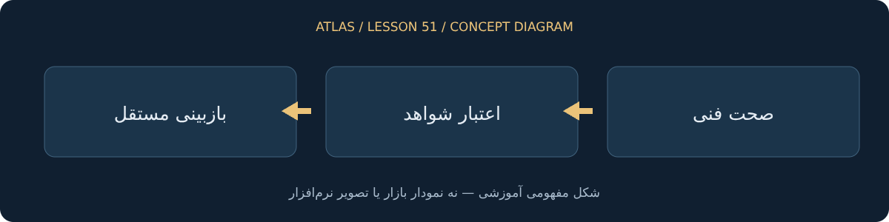

*شکل 51 — شکل مفهومی اختصاصی این درس؛ از راست به چپ بخوانید. این تصویر اسکرین‌شات نرم‌افزار نیست.*

### مراحل عملی

1. صحت داده و کنترل نشت: لینک تست و نمونه خطا ارائه کن.
2. صحت اجرا: سفارش مبهم، تکراری و بازیابی را نشان بده.
3. شواهد اقتصادی: خالص هزینه و افت سرمایه را گزارش کن.
4. دسترسی و امنیت: شرایط حساب و نبود اسرار در مخزن را بررسی کن.

### تمرین و خروجی قابل بررسی

یک نسخه آزمایشی را عمداً با داده قدیمی ارزیابی کن؛ نتیجه باید رد یا ناکافی باشد، حتی اگر نمودار سود مثبت است.

---

<!-- PAGE 52 -->

<a id="lesson-52"></a>

## درس 52 — منابع، فایل‌های همراه و پاسخ تمرین‌ها

**هدف:** مرجع ادعاها و روش ادامه مطالعه را پیدا کنی.

منابع زیر برای ساعات و حداقل ابزار، ابزار پژوهش، نشت اطلاعات و محدودیت AI هستند. آن‌ها تأیید کارگزار یا نتیجه سودآوری نیستند. شرایط جاری و نسخه نرم‌افزار هنگام اقدام باید دوباره بررسی شوند. اسکرین‌شات‌های واقعی این کتاب از JupyterLab و Backtesting.py/Bokeh هستند؛ اسکرین‌شات MT5 یا TradingView ارائه نشده چون حساب و محیط آن‌ها انتخاب نشده است.

پاسخ‌های کنترل: درس ۴ سود ناخالص ۰٫۶۰ دلار؛ درس ۵ خالص منفی ۰٫۱۵ دلار؛ درس ۶ زیان ۱۰۰ واحد؛ درس ۸ رد معامله؛ درس ۳۰ حجم نمونه ۹۰۸ واحد؛ درس ۴۴ امید منفی ۰٫۱R. این‌ها جواب مثال‌های مشخص‌اند، نه معیار سودآوری.


*شکل 52 — شکل مفهومی اختصاصی این درس؛ از راست به چپ بخوانید. این تصویر اسکرین‌شات نرم‌افزار نیست.*

### مراحل عملی

1. راهنمای بازتولید و فهرست تصاویر را در README ببین.
2. نوت‌بوک و CSV ساختگی را فقط برای یادگیری استفاده کن.
3. برای آزمون واقعی، داده مجاز و مشخصات معتبر تهیه کن.
4. برای تکمیل آموزش کارگزار، محیط انتخابی و نسخه آن باید مشخص شود.

### تمرین و خروجی قابل بررسی

سه محدودیت این نمونه را با زبان خودت بنویس؛ یکی درباره داده، یکی درباره اجرا و یکی درباره مدل.

### پیوندهای مرجع

- [S1: OANDA: instrument trading hours](https://www.oanda.com/bvi-en/cfds/hours-of-operation/)
- [S2: OANDA: platform minimum trade size](https://help.oanda.com/sg/en/faqs/minimum-trade-size.htm)
- [S3: Freqtrade: strategy customization and lookahead](https://www.freqtrade.io/en/stable/strategy-customization/)
- [S4: Backtesting.py: project documentation](https://kernc.github.io/backtesting.py/)
- [S5: Binance Spot API: filters](https://developers.binance.com/docs/binance-spot-api-docs/filters)
- [S6: CFTC: AI trading bot advisory](https://www.cftc.gov/PressRoom/PressReleases/8854-24)
- [S7: JupyterLab: user guide and notebooks](https://jupyterlab.readthedocs.io/en/stable/user/notebook.html)
- [S8: Telegram: Bot API](https://core.telegram.org/bots/api)

---
